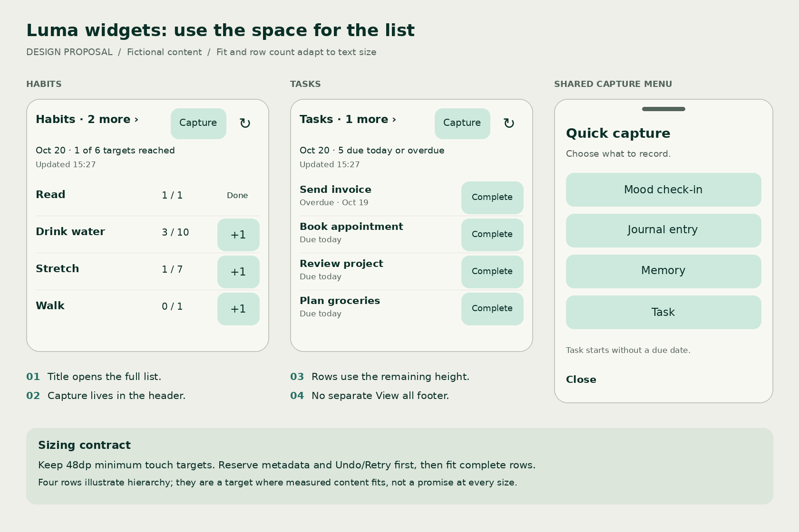

# Luma widget review: more useful rows and shared quick capture

**Reviewed:** 20 October 2026  
**Status:** WD01–WD07 implementation is in place. API 36 Pixel Launcher and focused renderer/store/navigation checks pass; WD07 capture-only upgrade acceptance and WD08 comparative/accessibility matrix remain open. See the [focused WD07–WD08 acceptance record](ui-ux-audit/evidence/widgets/wd07-wd08-2026-10-20/acceptance.md).
**Scope:** Android home-screen Habits, Tasks and Quick capture; their navigation, configuration, discovery and accessible sizing.

## Recommended direction

Make **Habits and Tasks the two primary widget choices**, with a **Capture** button on both. Move full-list navigation into the header and give the remaining height to complete habit/task rows. Reuse Luma’s existing quick capture sheet for Mood, Journal, Memory and Task.

Your observations are supported by the running app: there is substantial space below the full-list controls, and a separate capture widget is unnecessary for someone who already uses either data widget. However, the current Habits instance has only two eligible habits and Tasks is empty. Extra space alone cannot produce more records; a fixture with more eligible items is required to prove a row-count improvement.

This proposal updates two decisions from the [earlier widget review](WIDGET_UX_REVIEW_2026-10-20.md): retaining three equally promoted widget choices and retaining a three-row ceiling. Other requirements—per-instance privacy, truthful dates, separate row actions and dependable Undo/Retry—continue to apply. Existing [release acceptance gaps](WIDGET_ACCEPTANCE_2026-10-20.md) remain open.

## What I inspected

Used the already running **emulator-5554**, Android API 36, Pixel Launcher, 1080×2400 px, 420 dpi, English. Installed Luma reports **1.0.1 / version code 2**, last updated at emulator time 15:26:29 on 20 October. Inspected source at working-tree base `cbc3206`, including existing local modifications. No APK was rebuilt or installed, and installed/source binary equivalence was not established.

Inspected all three placed widgets, the Tasks destination, the existing quick capture chooser, its Memory editor, Habits configuration, widget discovery and its lower cards, 100%/200% system text, and the Habits/capture dark appearance. Opened configuration without saving changes and opened Memory without entering or saving content. Restored the original **100% font scale and System default app theme**. No task, habit or capture record was created or modified.

| Evidence | Observation |
| --- | --- |
| [Habits and capture, 100%](ui-ux-audit/evidence/widgets/density-capture-review-2026-10-20/01-launcher-baseline.png) | Two habits; a separate full-width View all row; unused area beneath it; three very tall capture tiles. |
| [Tasks, empty](ui-ux-audit/evidence/widgets/density-capture-review-2026-10-20/02-tasks-launcher.png), [task list](ui-ux-audit/evidence/widgets/density-capture-review-2026-10-20/03-task-list.png) | Empty widget retains a large footprint. View all tasks and Add task sit well above its bottom edge. |
| [Existing capture menu](ui-ux-audit/evidence/widgets/density-capture-review-2026-10-20/04-quick-capture-menu.png), [Memory editor](ui-ux-audit/evidence/widgets/density-capture-review-2026-10-20/05-memory-editor.png) | The reusable menu already offers Mood check-in, Journal entry, Memory and Task. Memory opens a new editor. |
| [Configuration](ui-ux-audit/evidence/widgets/density-capture-review-2026-10-20/06-habits-configuration.png) | Fictional details preview and Save/Cancel are visible at normal text. The existing instance has details enabled. |
| [Tasks, 200%](ui-ux-audit/evidence/widgets/density-capture-review-2026-10-20/07-tasks-large-text.png), [Habits/capture, 200%](ui-ux-audit/evidence/widgets/density-capture-review-2026-10-20/08-habits-capture-large-text.png) | Habits shows zero rows and “2 more.” Capture remains three narrow columns; English labels break into fragments such as “Moo / d” and “Me / mor / y.” |
| [Discovery](ui-ux-audit/evidence/widgets/density-capture-review-2026-10-20/09-widget-discovery.png), [capture and existing-instance cards](ui-ux-audit/evidence/widgets/density-capture-review-2026-10-20/10-widget-discovery-capture.png) | All three are promoted. Capture’s compact preview does not convey its tall placed appearance. |
| [Dark appearance](ui-ux-audit/evidence/widgets/density-capture-review-2026-10-20/11-habits-dark.png) | Existing dark colors preserve the identity; the same space allocation remains. This is visual inspection, not a contrast or screen-reader certification. |

The chooser was opened through the existing explicit `WidgetDestination.QuickCapture` route using live widget ID 5. **Neither data widget currently has the proposed Capture button.** This verifies the reusable destination, not the proposed interaction end to end.

Fresh populated Tasks, more-than-three-row datasets, mutations/Undo, injected errors, cold-start drafts, landscape, French/Persian and spoken TalkBack output were not exercised. They are acceptance work below; earlier tests are not substituted for fresh results.

## Findings and their causes

### 1. The footer consumes useful list height

From the saved accessibility bounds, using 420/160 = 2.625 px per dp:

| Measured area at 100% | Approximate size | Meaning |
| --- | --- | --- |
| Habits widget surface | 373×321dp | Actual placed surface, rather than a universal interpretation of “4×3.” |
| Two visible habit rows together | 104dp high | About 52dp per row in this sample. |
| View all habits target | 48dp high | Its minimum target size is appropriate. Its separate row is the expensive part. |
| End of View all target to widget bottom | 62dp | Includes approximately 12dp bottom padding; around 50dp remains beyond that padding. |
| Updated line + footer top gap + footer target | 72dp high | Supporting information/navigation consume over one sample row’s height. |
| Tasks: end of actions to widget bottom | 165dp | Empty-state space, not evidence of hidden tasks. |
| Separate capture surface | 277×210dp | A substantial extra home-screen allocation for three shortcuts. |

Raw bounds and derived sizes are in [measurements.json](ui-ux-audit/evidence/widgets/density-capture-review-2026-10-20/measurements.json), alongside the original UI XML files.

The XML vertically stacks header, metadata, rows, freshness and footer at the top of a fixed launcher surface. Removing an oversized-looking button background alone will not reclaim this space. Move navigation into the existing header and let row selection use the height it frees.

### 2. Taller widgets still stop at three rows

This is a source finding, not a newly observed four-item experiment. There are limits at several layers:

| Location | Current constraint |
| --- | --- |
| `WidgetLayoutPolicy.kt` | `MAX_ROWS = 3`; capacity is clamped to it. |
| `WidgetRenderer.kt` | Takes at most three rows before measuring. Uses the tallest candidate’s height for every row, which can waste capacity when just one title wraps. |
| `WidgetRefreshWorker.kt` | Both snapshot paths request `rowLimit = 3`. |
| `RoomWidgetStore.kt` | Rejects any row limit outside `0..3`; queries only the requested prefix. |

Changing just the XML or renderer constant cannot deliver additional rows end to end. The data contract, fetch limit, renderer and regression coverage must change together.

### 3. Capture is redundant for the requested workflow

The existing chooser already handles the four relevant destinations. A shared header entry saves home-screen space and avoids asking users to place a third widget. It costs one additional tap to reach Mood/Memory/Journal compared with the standalone direct buttons. That is a deliberate tradeoff for the user’s stated preference for fewer widgets.

### 4. Large text needs layout changes, not smaller text

The capture layout considers wrapped labels a fit even when a short English word is split into several fragments. Habits loses all rows at the sampled 200% placement. A new crowded header would repeat these problems unless it has a measured narrow/large-text arrangement.

### 5. The visual foundation is usable

Keep the cream/green palette, rounded surfaces, explicit +1 and Complete actions, clear dates and the details opt-in. The primary issue is allocation and hierarchy. Preserve the existing visual language while making navigation and repeated actions easier to distinguish.

## Proposed experience

This is a schematic, not a screenshot or verified implementation. Four rows illustrate the intended use of height; actual capacity depends on width, typography, metadata, feedback and title lengths.

### Header and full-list navigation

Use one normal header row: **Habits › / Tasks ›**, **Capture**, **Refresh**. The title/chevron block opens the corresponding full list. Remove the separate View all footer. Explain the title action in discovery/configuration copy: “Tap the title to view all.”

Give each interactive region at least a 48×48dp target and separate adjacent actions. Keep Capture text visible in the normal layout; a bare plus could be mistaken for adding a habit or completing a task. Refresh may remain an icon with an accessible name. Small icon artwork can sit inside the larger touch target, consistent with [Android touch-target guidance](https://support.google.com/accessibility/android/answer/7101858?hl=en).

When rows are omitted, add a subordinate “2 more” cue inside the same title navigation region if it fits. Its accessible name becomes “View all habits, 2 more not shown,” or the Tasks equivalent. Calculate omitted count from the full eligible total minus actually rendered rows, including anything outside the fetched prefix. Summary mode must say that names are hidden, rather than suggesting a missing list is an error.

### Metadata and rows

Keep the localized snapshot date and scope/progress near the header. Keep a quiet Updated time immediately below it; avoid another footer band. In a constrained layout, combine supporting metadata only when the complete date, scope and truthful freshness fit. Preserve the tracking zone when relevant and the full update date for an older snapshot.

For Habits, use a compact horizontal row when it fits: **name | count/target | +1**. A reached target has an explicit reached/done label and no enabled +1. Skipped states remain explicit. Wrap long names and move progress beneath the name when needed. Do not remove progress to fit an extra row.

For Tasks, keep **title + due/overdue label | Complete**. Allow up to two title lines; expose the full title and state accessibly. The title area opens details; the action changes the record. These targets must remain separate.

Measure each candidate row at its real remaining text width, including action label, progress and gaps. Fill the available height with complete rows in the existing order. Do not stop because one earlier row is taller than its neighbors. Do not stretch rows/buttons to occupy an otherwise empty widget.

Use a bounded prefix of **up to eight candidates** initially, shared across worker/store/renderer. Eight is an engineering ceiling for this proposal, not a claim that every placement displays eight. Show the omitted count beyond that ceiling. Reserve the shell and feedback before choosing rows; never issue or reuse the wrong row token when rows change.

### One Capture button on either widget

`Capture → existing QuickCaptureSheet → selected editor → explicit Save or Cancel`.

Reuse the existing stable menu order: **Mood check-in, Journal entry, Memory, Task**. Preserve its existing Task explanation: “Starts without a due date.” Opening the menu does not inherit a previously browsed timeline date or a stale habit snapshot date. New life records use the existing current-time behavior.

The populated Tasks footer’s direct Add task shortcut moves into this menu. This adds a tap and changes the default compared with the current widget-specific Add task action, which preselects today. Make that distinction explicit: keep **Add task due today** as the empty-state primary action, while the shared menu’s **Task** remains undated. Do not silently make identical shared menu items behave differently depending on the widget.

Opening capture must not depend on a successful data refresh or details consent. Retain access while the data is empty, names are hidden or a read has failed, provided the size allows it alongside required recovery. Avoid duplicate sheets on repeated taps. Respect existing editor/draft protections; no capture is saved by tapping the widget.

### Compact sizes, feedback and empty states

| Situation | Required behavior |
| --- | --- |
| Normal details | Header actions, date/scope, freshness, then as many complete rows as fit. |
| Header labels cannot fit horizontally | Use a second header action line with labeled Capture and Refresh; remeasure rows. Do not split Capture into fragments. |
| Very short/narrow placement | Use the existing compact-shell approach. Keep date/state and primary recovery or list navigation; retain Capture where a full target fits. Never clip an action or shrink typography. |
| Details hidden | Show summary only, with list navigation and Capture. Never fill unused height with real names. Recommend resizing down. |
| No habits/tasks in library | Short, specific copy and an Add habit/Add task due today action. Avoid a redundant full-width View all band. |
| Library exists, none eligible today | “No habits scheduled for this date” / “No tasks due today or overdue.” Keep navigation to the wider list. |
| Successful mutation | Persistent compact confirmation with Undo and Dismiss; fewer rows may fit. |
| Failed mutation | Retry the original token; preserve recovery before extra rows. |
| Read failed/setup required | Distinct failure/setup copy and direct recovery. Never present unknown counts as zero. |

Density yields to readable controls, consent, truthful state and Undo/Retry. At 200% text, accept fewer rows and a taller header. Evaluate fit using measured translated content, not only launcher cell labels; Android documents [responsive and exact-size widget layouts](https://developer.android.com/develop/ui/views/appwidgets/layouts).

### Retiring the third widget without breaking existing placements

Make the product’s main discovery area show **Habits and Tasks only**, both described as including quick capture. Stop promoting the separate capture widget as a necessary companion.

For the first transition release, retain `QuickCaptureWidgetProvider` and its existing direct actions as a compatibility option. Existing pinned instances must keep working. Label it as the legacy capture-only choice where exposed, and explain that capture is now available in the other widgets. Fix its large-text word fragmentation while it remains supported. Do not automatically remove it or imply that the app can reclaim someone’s launcher layout.

This intentionally leaves a compatibility entry in the system picker for that release. Hiding it from new picker placement while retaining existing instances needs a verified platform approach; disabling/removing the receiver is not a safe substitute. Full provider removal is a separate migration decision after upgrade testing, not a prerequisite for delivering shared capture.

## Options considered

| Approach | Benefit | Cost / decision |
| --- | --- | --- |
| **Two primary widgets with shared Capture** | Meets the requested workflow; frees the footer and third-widget footprint. | Extra capture choice tap; recommended. |
| Keep all three equally promoted; only tighten spacing | Preserves one-tap direct editors. | Continues to consume a separate capture placement and does not resolve the product simplification request. |
| One combined Habits + Tasks + capture widget | One placement. | Competes for rows and mixes habit tracking dates with task due-date scope; defer. |

## To-do tasks

WD01–WD03 implementation bullets are complete. P1 means the next implementation scope; P2 means follow-up polish/transition. Acceptance gates are required before claiming the redesign is ready.

### WD01 — Replace the footer with header navigation and Capture — P1 — implemented

- [x] Update `widget_data.xml` and `WidgetRenderer.kt`: clickable title/chevron region, labeled Capture, retained Refresh; remove the normal View all/Add task footer band.
- [x] Add full-list accessible names and omitted-count cue in the title region. Remove obsolete PendingIntents, labels and view children during reapplication.
- [x] Update `WidgetCompactRenderer.kt` and compact XML with measured fallbacks rather than squeezing three targets into a narrow header.

**Acceptance:** Both titles open their matching lists; Capture opens the shared chooser; Refresh refreshes the matching instance. At equal bounds there is no separate normal footer band. Bounds prove separate 48dp targets and no clipped/wrapped-fragment action labels at 100/130/200% in en/fr/fa.

**Status:** Implemented; renderer checks pass on API 36, including en/fr/fa at 100/130/200% and separate 48dp targets where actions fit. End-to-end launcher taps and TalkBack validation remain pending.

### WD02 — Extend the row pipeline beyond three — P1 — implemented

- [x] Replace the three-row constraints in `WidgetLayoutPolicy.kt`, `WidgetRenderer.kt`, `WidgetRefreshWorker.kt` and `RoomWidgetStore.kt` with the shared bounded eight-candidate contract; document it at `WidgetStore`.
- [x] Reserve measured shell/feedback height, measure rows individually and render the complete ordered prefix that fits. Keep summary mode free of real rows/tokens.
- [x] Cover store limits, actual rows four through eight, mixed title heights, hidden totals beyond eight and correct per-row mutation tokens.

**Acceptance:** With eight eligible records at 100% English, an expanded 373×420dp placement displays at least four complete rows for each provider. At the recorded 373×321dp placement, record actual before/after counts with identical fixtures; target one additional row wherever measured content permits. At 200%, verify bounds rather than enforce the normal-text count. Enlarging a widget cannot reduce its row count when width, data, typography and feedback are unchanged. No partial row appears.

**Status:** Implemented; store checks cover limits 0/8/9 and per-row tokens, while renderer checks show at least four rows for both kinds at 373×420dp and up to eight in expanded space. Comparative 373×321 before/after and monotonic resize measurements remain pending.

### WD03 — Compact the row composition — P1 — implemented

- [x] Update `widget_habit_row.xml`, `widget_task_row.xml` and corresponding measurement/binding: inline habit progress when it fits; stacked fallback for long names; separate navigation and mutation targets.
- [x] Preserve +1, Complete, reached/skipped state, overdue metadata, existing order and complete accessible item names.

**Acceptance:** Long and mixed-script titles, large targets/counts, reached/skipped habits and overdue tasks retain readable state. Row navigation never completes/logs an item. Full localized action labels fit; title truncation has an accessible full-name equivalent.

**Status:** Implemented; automated checks cover inline/stacked habits, reached/skipped copy, overdue task state, full accessible names and separate action targets. TalkBack and broader large-text row-state checks remain pending.

### WD04 — Wire and verify shared capture — P1

- [x] Bind both widgets with `WidgetIntents.navigation(..., WidgetDestination.QuickCapture)`; reuse the existing `LifeOsApp.kt` and `QuickCaptureSheet.kt` flow.
- [x] Keep current-time capture, undated shared Task behavior, explicit Save/Cancel and editor/draft protections. Ensure capture remains available in summary/empty/error states when it fits.
- [ ] Exercise both widget origins, repeated taps, cold/warm app, a browsed historical day, an old snapshot and an existing draft. Check each of the four menu destinations. API 36 route/provider tests pass; cold/warm, historical-date, draft and Back/Close acceptance remains pending.

**Acceptance:** One tap opens exactly one chooser; a second opens the chosen editor. No record is saved by navigation, no stale date leaks into capture, and existing edits are not silently replaced. Back/Close dismisses the sheet predictably without a navigation loop.

**Status:** Implemented. Both widget entry points use the date-free shared chooser, and the chooser opens the existing editors. Save/Cancel and draft protections remain in those editor flows. The API 36 route/provider test passes 3/3; cold/warm launcher, historical-date, existing-draft and Back/Close acceptance remains pending. See the [focused WD07–WD08 acceptance record](ui-ux-audit/evidence/widgets/wd07-wd08-2026-10-20/acceptance.md).

### WD05 — Preserve recovery and clarify empty states — P1

- [x] Carry existing persistent Undo/Retry/Dismiss behavior into the new height budget and clear old actions on reapply.
- [x] Add the explicit empty-state actions and distinct no-library/no-eligible/read-failed copy described above. Preserve actual freshness and tracking-zone meaning.

**Acceptance:** Complete the last visible task or reach a habit target: Undo remains reachable after its row changes/disappears. Retry reuses the failed command. Read failure never appears as an empty library. Header capture never submits a mutation.

**Status:** Implemented. Empty libraries now offer Add habit or Add task, with the task scheduled for today; a library with no eligible items keeps its separate explanatory state and list navigation. Normal and compact layouts retain persisted recovery actions ahead of optional rows. Renderer coverage was added and compiles; mutation/Undo/Retry launcher checks remain part of manual acceptance.

### WD06 — Update discovery, previews and setup — P2

- [x] Update `WidgetSettingsRoute.kt`, `WidgetExample.kt`, both data-widget picker previews/provider descriptions and values/values-fr/values-fa strings for the new two-primary-widget model.
- [x] Show fictional summary/details examples with the new header. Explain title navigation, capture and details consent. Keep details hidden by default for new instances.
- [x] Preserve scrolling setup and reachable Save/Cancel; do not reset consent when upgrading existing instances.

**Acceptance:** In-app and picker previews match the new hierarchy and clearly identify fictional data. Users can find capture without placing another widget. First placement, cancel and reconfiguration do not disclose names before consent.

**Status:** Implemented. In-app discovery promotes Habits and Tasks and explains shared Capture and title navigation. Both launcher previews and configuration examples show the new header and fictional content. New instances still default to summary mode, and existing saved consent remains the configuration source. Preview/configuration test sources compile; launcher placement and upgrade checks remain pending.

### WD07 — Transition the legacy capture provider — P2

- [x] Remove its primary in-app promotion; retain the registered provider and existing editor routes for upgrade compatibility.
- [x] Adjust discovery and picker copy consistently. At large text, choose a readable stacked/grid/fallback arrangement without splitting words.
- [x] Explain manual removal without deleting launcher placements automatically. API 36 same-version in-place install preserves the existing mixed Habits/Tasks placements.
- [ ] Verify an already-pinned capture-only placement across upgrade. The validation emulator had no standalone capture instance before the update.

**Acceptance:** Existing standalone widgets continue opening the correct editors after upgrade. The main in-app discovery promotes two widgets. Any remaining system-picker compatibility entry is described honestly. Full retirement stays separate until its migration is verified.

**Status:** Implemented; API 36 system-picker registration, compatibility copy, direct editor route tests and mixed Habits/Tasks placement survival pass. Capture-only placement survival across upgrade remains unverified. See the [focused WD07–WD08 acceptance record](ui-ux-audit/evidence/widgets/wd07-wd08-2026-10-20/acceptance.md).

### WD08 — Record comparative acceptance evidence — release gate

- [x] Record renderer row counts for 0/1/3/4/8/>8 items, long titles and no-feedback/Undo/Retry states at compact, recorded and expanded bounds.
- [ ] Capture identical-fixture before/after launcher screenshots. Current before and after screenshots have different item counts and are not a controlled comparison.
- [x] Exercise renderer layouts for en/fr/fa at 100/130/200%, portrait/landscape bounds, summary/details, feedback and separate actions on API 36.
- [ ] Test API 28/35, another launcher, actual landscape, light/dark and duplicate same-provider instances.
- [ ] Manually check TalkBack speech/focus, keyboard traversal and contrast.
- [x] Run focused sizing/store/renderer/navigation checks, app JVM tests, APK packaging and lint. Record remaining combinations explicitly.

**Acceptance:** Publish measured row-count gains and target-bound evidence, not an assumed percentage. Capture works from both widgets, legacy placements survive upgrades, and setup/recovery remains operable. Retain existing release blockers until their own acceptance requirements are met.

**Status:** Partial; API 36 renderer/store/provider/navigation evidence is recorded, but controlled before/after screenshots and the broader launcher, device and manual accessibility matrix remain release gates. See the [focused WD07–WD08 acceptance record](ui-ux-audit/evidence/widgets/wd07-wd08-2026-10-20/acceptance.md).

## Delivery order and success measures

WD01–WD07 implementation is in place. Complete the standalone capture upgrade check and remaining comparative accessibility/sizing evidence in WD08 before release. Updating the row limit or removing a footer in isolation is insufficient.

Success means more **complete, actionable rows** where data and measured space allow; **two promoted widget choices**; capture from either widget in **two taps to an editor**; and no regressions in consent, dates, recovery or accessible interaction. Ask a small formative group to find capture, open the full list and log/complete an item without coaching. These are proposed validation activities, not research already performed.

The review document, raw evidence, measurements and schematic are the outputs of this task. WD07 implementation is in place; its standalone placement upgrade acceptance and WD08 manual release matrix remain open.
