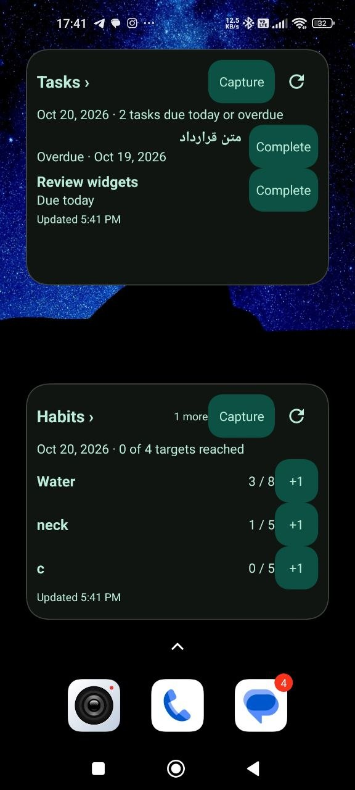
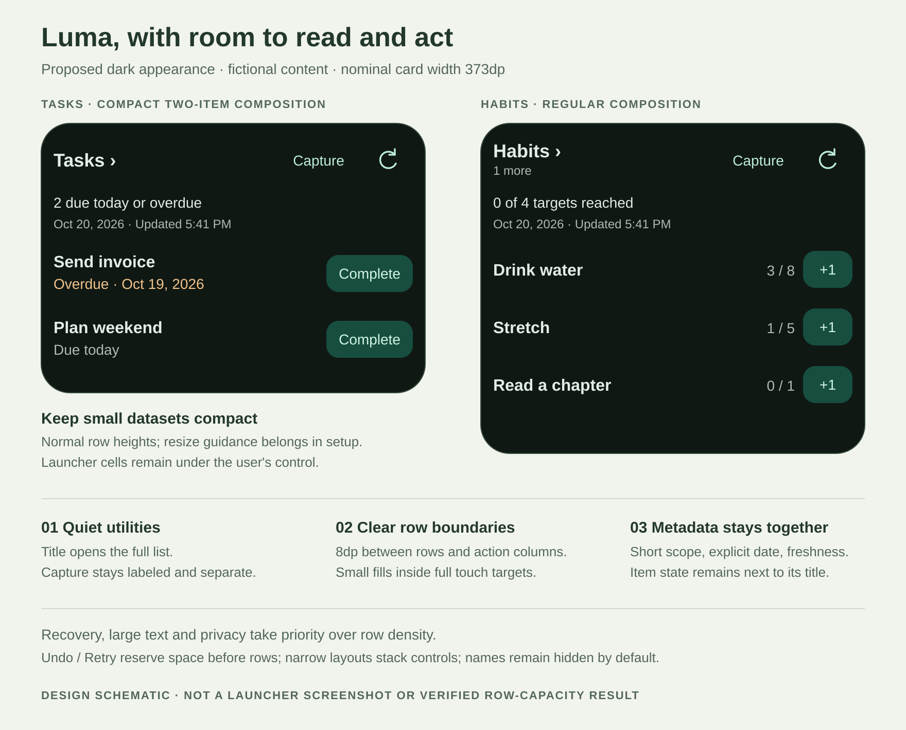

# Luma Habits and Tasks widgets — visual redesign review

**Date:** 20 October 2026<br>
**Status:** Design proposal and implementation backlog. WD09–WD15 and WD17 remain partial. API 36 Gradle/emulator evidence was added 21 October for the widget instrumentation package, collection store, and synthetic renderer matrix. Live launcher scrolling, the wider device/accessibility matrix, and formative research/sign-off remain open under WD15–WD17.
**Scope:** Improve the existing Habits and Tasks home-screen widgets shown in the supplied screenshot, including vertical scrolling when items exceed the available list area. Retain shared Capture, existing providers, per-instance privacy and dependable recovery. This review remains the design/backlog reference; WD09 and WD10 implementation evidence is linked below.

**User requirement added:** Both data widgets must let users scroll through additional eligible items within the current widget size. Resizing or opening the app must not be required just to reach overflow items. The scrolling contract and WD17 below supersede the earlier static-prefix/eight-candidate proposal.

## 1. Design brief and recommendation

The requested outcome is a more polished, useful widget, with a complete solution and development tasks in a review document. I interpret this as improving both widgets in the screenshot as one visual family. The working assumption is that their primary jobs are to identify the next task or habit and let the user act quickly from the launcher. There is no new user research behind that assumption.

**Recommended direction:** keep the current green identity and two-widget model; make the content lead. Use a quiet header, short date/scope metadata, clearly separated row actions and a vertically scrollable item list. Preserve explicit **Complete** and **+1** labels. Make spare space understandable through a compact composition and resizing guidance in setup; use scrolling for overflow at the user's chosen size.

The design succeeds when a user can identify the widget, scan item state, distinguish opening an item from changing it, and find Capture without coaching. Useful density matters, but larger touch targets, full recovery and truthful state take precedence over the number of rows.

| Approach | Benefit | Tradeoff / decision |
| --- | --- | --- |
| **Refine the current lists** | Preserves familiar actions and navigation; improves everyday scanning with limited scope | Recommended; requires coordinated layout and measurement changes |
| Replace Complete with a checkbox | Frees horizontal space | Changes an established action cue and recovery expectations; defer until tested with users |
| Combine Habits and Tasks into one dashboard | One launcher placement | Splits row capacity and mixes date meanings; outside this review |

This proposal continues [the density/shared-capture review](WIDGET_DENSITY_CAPTURE_REVIEW_2026-10-20.md). It refines that document's button guidance and replaces its static eight-candidate presentation with a scrollable collection that can reach all eligible items. The existing pipeline is the implementation baseline, not the new dataset limit. Shared capture and compatibility providers remain. Successful freshness belongs with metadata **above the list**, rather than directly after the last item.

## 2. Evidence: observed, verified in source, and still unknown



The supplied image is 576×1280 pixels. It shows a dark launcher with two task rows and three visible habit rows, plus a “1 more” cue. Device model, launcher, display density, font scale and APK identity cannot be established from the image. Do not convert its pixels into dp or treat it as the API 36 test device.

| Finding | Evidence and consequence | Design response |
| --- | --- | --- |
| Repeated buttons visually join | Complete and +1 fills touch the next row's fill. Separate rows look like one vertical control | Add actual inter-row space; inset each button's visual fill inside its own full touch target |
| Capture competes with row actions | Its filled green shape has similar emphasis to completion/logging | Use a plain labeled utility action with pressed/focus feedback; keep Refresh visually subordinate |
| Metadata competes with titles | Full date and verbose scope span the card; most text uses the same mint color | Separate concise scope from secondary date/freshness and use semantic text roles |
| Tasks has a large blank tail | Only two eligible tasks are indicated and both appear visible | Show two normal rows, keep content grouped, and offer resize guidance in setup; do not infer missing records |
| Hidden-count cue drifts toward Capture | Habits' “1 more” sits far from its title | Put it under the title within the same navigation target |
| Mixed-script task is difficult to scan | The Persian title sits against the action column while the English due label begins at the other edge | Keep row geometry tied to interface direction; allow title paragraph direction to follow its content |
| Counts crowd the habit actions | Progress and +1 have little visual separation | Align counts in a stable column with an explicit gap before the action |
| Freshness resembles item metadata | Updated appears immediately under the last visible row | Group it with snapshot metadata above the list |

Source inspection confirms zero vertical padding in task and inline-habit rows, the same filled drawable for Capture and row actions, no explicit margin between the inline habit count and its action, and a horizontal title/hidden-count group. `widget_data_updated` follows `widget_data_rows` in `widget_data.xml`. Row height and header width are also calculated separately in `WidgetRenderer.kt`; XML changes must be reflected in those calculations.

The [WD07–WD08 acceptance record](ui-ux-audit/evidence/widgets/wd07-wd08-2026-10-20/acceptance.md) is a separate source of measured evidence: with four or more eligible items, its long-title fixtures at 373×321dp show three rows without feedback, two with Undo and one with Retry; at 220×160dp they show no rows. This demonstrates sensitivity to shell and recovery height. It does not prove the supplied screenshot has the same bounds or that this redesign will add a row. The earlier 262/262 JVM result and 19/19 renderer result certify their recorded build and scope, not this proposal.

No new device interaction, contrast measurement, assistive-technology run or usability study was performed for this review. Visual findings are expert judgments; spacing, copy and layout targets below are proposed requirements.

## 3. Proposed visual composition



[Editable vector reference](ui-ux-audit/evidence/widgets/visual-review-2026-10-20/proposed-widgets.svg). The reference illustrates the regular dark appearance at a nominal 373dp card width. All names are fictional. It is a design schematic, not a running widget, a measured renderer result or an exact Android text-layout specification. The reference shows a two-item compact composition and a populated habits composition; they do not promise automatic launcher resizing.

**Scrolling revision:** This static reference predates the added scrolling requirement. Its “1 more” cue is superseded by the total-count/scroll-hint rules below; remaining items belong to the same scrollable list, rather than being omitted. The illustration does not demonstrate scrolling or its acceptance.

### Header: identity first, utilities second

- Keep **Tasks ›** and **Habits ›** at 18sp, bold. The title block opens the corresponding full list and reserves a minimum 48dp height. Use the existing directional chevron, mirrored for RTL.
- When useful and space permits, show the total eligible item count below the title, such as **4 habits**, at 12sp. The title remains one destination named “View all habits” / “View all tasks.” Do not label offscreen scrollable items as omitted or calculate a static “N more” from the initial viewport.
- Keep **Capture** visible at 14sp with a plain/transparent resting treatment. Reserve at least 48dp in both dimensions; width grows with the translated label. Use visible pressed and keyboard-focus states. Keep the existing 24dp Refresh artwork inside its separate 48×48dp target.
- Reserve 8dp between title, Capture and Refresh targets. At narrow widths or large text, put Capture and Refresh on a second header line and remeasure the body. If even that cannot fit the required state, use the existing compact recovery shell.
- Do not add a settings gear, overflow menu or a second Add control to the normal header. Configuration remains available through the existing setup/settings flow.

### Metadata: short, explicit, and together

Use this order below the header:

```text
Tasks:   2 due today or overdue
         Oct 20, 2026 · Updated 5:41 PM

Habits:  0 of 4 targets reached
         Oct 20, 2026 · Updated 5:41 PM
```

Scope is 14sp; date/freshness is secondary 12sp. Use localized plural resources, date formatting and the established hour-cycle policy. The task scope includes overdue work; “2 tasks today” would be ambiguous. Keep the year in the localized date. “Updated” is the successful snapshot update, not last tap time.

The existing snapshot exposes task total but no full-scope overdue subtotal. Do not introduce “2 open · 1 overdue” by counting only visible/fetched rows. This proposal uses available totals and requires no new summary query.

The schematic's one-line date/freshness is conditional on fit. Wrap metadata naturally when a locale, tracking zone, old update date or larger font needs it. When the snapshot and update dates differ, show both dates explicitly. Preserve the habit tracking zone when it differs from the device zone; preserve the existing distinct meaning of civil task dates. A stale snapshot must never be relabeled Today. Compact recovery may omit optional freshness only under the existing truthful-state policy.

### Tasks: make each item a distinct row

- Keep title plus due-state text in a dedicated navigation block; **Complete** stays a separate trailing action. Tapping text opens details; tapping Complete submits the existing command.
- At regular text, use a minimum 56dp content row with an 8dp gap between rows. Grow naturally for two-line titles, wrapping translations and large text; do not force all rows to the tallest candidate.
- Reserve 8dp between the text target and completion target. Keep the completion target at least 48dp high and wide enough for the full translated word, including horizontal padding. Do not replace it with a checkmark in this delivery.
- Draw a smaller 36dp-high rounded fill centered inside the full 48dp minimum target at normal text. Use a 12dp visual corner radius. The entire target, including the inset area, invokes the same action. Let the fill grow when the label needs it. This is one target, not two nested interactive controls.
- Use **Overdue · Oct 19, 2026** and **Due today** when true for the snapshot/device date context. Show overdue text in a semantic warning color as well as naming its state. Retain a real due date for older snapshots instead of producing a misleading relative label.
- Allow two title lines, then end ellipsis; expose the full original title and due state to accessibility and on the detail destination. Do not alter stored titles to improve layout.

### Habits: clear name, progress, and increment columns

- Use **name | count / target | +1** where measured content fits. Use a minimum 48dp row and 8dp between rows. Align progress at the end of its column, with an 8dp gap before the independent +1 target.
- Reserve a consistent progress-column width for the collection using measured localized labels and the available width, rather than allowing counts to drift as rows scroll into view. If a value or title cannot fit this budget, use the existing stacked name/progress form for that row and measure its actual height.
- Give +1 the same inset visual treatment as Complete within a full 48×48dp minimum target. Keep the visible plus sign and digit; an unlabelled plus could mean creating a habit.
- Keep exact **3 / 8**, **1 / 5** progress as text. A progress bar adds height and duplicates the value, so it is outside this slice.
- Reached and skipped rows keep their explicit state and progress; they do not offer an enabled +1. Distinguish “Target reached” and “Skipped” from pending or failed actions through words, not only color.

### Mixed-script layout

Treat layout direction, paragraph direction and alignment as separate decisions. Row columns follow app locale: text then trailing action in English/French, mirrored in Persian. Title text uses first-strong paragraph direction while remaining aligned to the navigation block's interface start edge. In the English interface a Persian title remains in the left content column and reads RTL within it. In the Persian interface the content column and actions mirror together.

Due labels use interface language; user titles retain their original script and punctuation. Isolate interpolated titles, dates, counts and zone identifiers with the existing bidi helpers where needed. Never reverse strings or insert layout spaces into user content. Validate Persian/English mixed titles with numbers, parentheses and a leading emoji; do not rely solely on the all-English schematic.

## 4. Space, sizing and visual tokens

| Element | Proposed contract |
| --- | --- |
| Outer surface | Existing opaque semantic light/dark surface and provider/host corner handling; no new shadow or translucent wallpaper effects |
| Insets | Retain 12dp outer inset initially to protect row capacity; align all text to that same start edge |
| Header targets | At least 48dp high; 8dp horizontal separation; grow/stack when labels require it |
| Header to scope | 4dp; scope and freshness may wrap |
| Metadata to rows | 8dp |
| Row separation | 8dp **between** adjacent rows; no trailing gap after the final row |
| Text to trailing action | 8dp, applied in both XML and width measurement |
| Text | Title 18sp bold; item 16sp bold; scope/state/actions 14sp; date/freshness/cue 12sp; respect system scaling |
| Color roles | Primary content, secondary metadata, utility action, mutation fill/on-fill, overdue warning, error, focus indicator |
| Contrast acceptance | At least 4.5:1 for text in this design, and 3:1 for meaningful icons/control indicators against adjacent colors; measure actual light/dark and pressed/focused states |

The dark reference uses candidate colors to illustrate hierarchy: surface `#101813`, primary text `#E1EEE5`, secondary `#ADBCB1`, utility `#BCEEDB`, mutation fill `#174E40`, mutation text `#D1F5E3`, and overdue `#F0C38B`. These are design candidates, not approved production tokens or measured contrast evidence. Map equivalent light roles to the existing palette and measure before adoption; avoid copying dark values into light resources. Keep secondary text readable rather than dimming it with arbitrary opacity.

Android recommends separating a smaller visual affordance from a sufficiently large clickable area, including a target of at least 48dp and separation around adjacent targets. The inset fill follows that approach. [Android touch-target guidance](https://support.google.com/accessibility/android/answer/7101858?hl=en).

### Scrollable list and available space — required

Both Habits and Tasks must support **native vertical scrolling inside the item area** whenever their eligible content exceeds that area. Keep the current habit schedule scope, due-today/overdue task scope and existing order. Scrolling reveals the remaining items in that scope; the title still opens the wider app list when wanted.

1. Keep the header, Capture, Refresh, scope/date/freshness and persistent Undo/Retry strip fixed outside the list. Only item rows scroll. A user who completes an item near the end must still be able to reach Undo without scrolling back to the first row.
2. Give the collection the remaining height after the measured shell and feedback. Growing the widget increases its viewport; shrinking it reduces its viewport without discarding eligible rows. Avoid a nested scrolling parent or horizontal scrolling.
3. If every item fits, the list rests normally without unnecessary scroll hints. If it overflows, show a subtle native vertical scrollbar and a localized **Scroll for more** hint immediately above the list when space permits. Name the collection and its total accessibly. Never rely on the hint alone; TalkBack and keyboard users must be able to move through the collection.
4. Expose **all eligible items**, including item nine and later. Replace the current eight-candidate ceiling for this collection path. Use bounded database reads/lazy row creation so reaching item 50 or 500 does not require shipping an unbounded set of RemoteViews in one update. Loading more must remain within the widget; opening the app is optional.
5. Preserve the native scroll position across ordinary refreshes and unrelated feedback updates where the host permits. Use stable record identity; do not deliberately scroll to the top on every update. When the anchored item disappears, keep the nearest remaining neighbor where possible. New date/scope, changed privacy mode or explicit reconfiguration may reset to the start. Launcher restart/rotation restoration must be tested; exact pixel restoration is not assumed across all hosts.
6. A vertical drag/fling scrolls and must not activate a row or submit +1/Complete on release. An intentional tap retains the separate navigation/mutation behavior. Scrolling never changes data, reveals names without consent or opens the app.
7. Native viewport clipping while scrolling is expected. Text and controls inside each row must remain unclipped, and the user must be able to bring each actionable row fully into view. If the remaining height cannot hold one usable row at the current text scale, use the compact summary/recovery shell with list navigation and resize guidance; do not expose a tiny unusable scroll region.

The viewport budget is:

```text
listViewportHeight = availableWidgetHeight − shellHeight − feedbackHeight
```

Shell height includes padding, selected header, metadata, the optional scroll hint and state-specific controls. Reserve recovery first. Apply 8dp between collection rows, without padding the entire dataset to the widget height. Resolve the habit progress column from a consistent measured width budget for the collection; do not let columns jump while scrolling as different counts enter the viewport. Fall back to stacked rows where required.

Record initial fully visible row counts alongside the new measure: **every eligible item is reachable by scrolling at fixed bounds**. Protect the previous complete-row density at 373×321dp and 373×420dp where measured content permits, but do not achieve it by clipping row content or shrinking type, targets or recovery. A larger viewport must not reduce the number of fully visible rows when content, width and state are unchanged.

### Android implementation direction

Use a native RemoteViews **ListView** collection instead of adding rows to a plain LinearLayout. Support API 28–30 with `RemoteViewsService` / `RemoteViewsFactory`; for API 31+ choose the supported collection adapter path according to dataset size. Keep lazy/service-backed loading for large collections; use `RemoteCollectionItems` only when the payload is demonstrably small. Register any collection service with `BIND_REMOTEVIEWS` and keep persistent data in the existing database. Android documents these collection mechanisms and version-specific options. [Android collection widgets](https://developer.android.com/develop/ui/views/appwidgets/collections).

Collection children require pending-intent templates and fill-in intents; the existing independent child PendingIntents cannot simply be copied. Design instance-scoped routing that distinguishes record navigation from the existing background command execution, validates stable record/token identity rather than adapter position, and respects current activity-launch restrictions. Preserve direct row navigation and in-widget mutations without unwanted app opening; verify this on the target APIs before signing off. [Android collection item interactions](https://developer.android.com/develop/ui/views/appwidgets/collections).

### Small datasets and resizing

For a two-task dataset, two rows are the truthful result. Keep them top aligned at their normal size; do not stretch buttons, add empty row placeholders or add unrelated motivational content. A widget cannot automatically shrink its allocated launcher cells. In setup/discovery, say “For a shorter list, resize this widget on your home screen” and illustrate a compact placement. Do not add this instruction to every populated widget refresh. Change default provider size only after verifying placement and recovery in both launchers; existing placements must retain their size.

Use measured compact/regular/expanded layouts rather than promising a fixed count per launcher cell label. Android's responsive and exact-size layouts support this approach; older API fallback remains required. [Android flexible widget layouts](https://developer.android.com/develop/ui/views/appwidgets/layouts).

## 5. Interaction and state contract

| State / trigger | Visible result and available action |
| --- | --- |
| Tap title / row text | Open the correct full list / item detail; never log or complete |
| Tap Capture | Existing chooser: Mood check-in, Journal entry, Memory, Task; Task remains undated. No save occurs on navigation |
| Tap Refresh | Refresh that instance; preserve a qualified safe snapshot if available and show pending state without changing successful freshness prematurely |
| Tap +1 / Complete | Pending treatment on the matching action; prevent duplicate submission under the existing command model; retain useful unrelated navigation |
| Successful mutation | Persistent result naming the action plus Undo and Dismiss, above rows; may reduce capacity. It survives row removal and refresh under existing policy |
| Undo / failed mutation | Undo uses the persisted inverse token; failed mutation offers Retry of the original token and Dismiss. Do not recreate the mutation from visible text |
| Undone / conflict / missing | Show truthful result; conflict/missing opens the relevant list for review. Do not leave a success-colored enabled control bound to an obsolete record |
| Read failure | Distinct “Couldn't update” state with Refresh; unavailable totals remain unknown. Capture stays available when recovery and size permit |
| Loading / setup required | Named loading state or Set up for that live instance. Required setup and recovery outrank optional rows/utilities |
| Details hidden | Show date, scope, “Names hidden” and permitted utilities; no names, real row previews or mutation tokens before consent |
| Empty library | Specific no-habits/no-tasks copy and Add habit / Add task due today; title navigation and Capture when they fit |
| Library exists, none eligible | “No habits scheduled for this date” / “No tasks due today or overdue”; do not imply the whole library is empty |
| More items than fit | Scroll the list vertically to reach every eligible item at the same widget size; fixed utilities/recovery remain reachable; full-list navigation stays optional |
| Collection page/row load failure | Preserve safe loaded content, identify the load failure and offer Retry; failure must not look like the end of the list or an empty library |

All feedback controls retain full targets. Use a stacked strip when translated feedback/actions cannot fit inline. Never dismiss Undo or errors on a timer to improve appearance. Reapplication must remove stale rows, PendingIntents, hidden-count labels and obsolete accessibility descriptions before binding the new state. Keep the earlier capture/draft, date and legacy-provider contracts intact.

TalkBack should encounter title navigation, Capture, Refresh, scope/freshness, feedback when present, then the named scrollable collection and each item text/action pair. Its scroll actions and keyboard traversal must reveal offscreen rows without trapping focus. Summary/date text remains readable without becoming duplicate navigation stops. Each mutation label identifies its item and action, for example “Log one repetition for Drink water, 3 of 8” or “Complete Send invoice, overdue October 19.” Announce acknowledged changes without repeatedly forcing focus to the header; after row removal, verify that focus moves to a sensible remaining item or result. Test actual speech and keyboard traversal in the launcher.

## 6. Implementation tasks

WD09 and WD10 are partial; WD11 and WD12 have implementation changes with acceptance evidence pending; WD13, WD14 and WD17 have source changes with acceptance evidence pending; WD15 has a source/evidence review recorded but device/accessibility evidence remains open; WD16 is partial with formative research and user sign-off pending. P1 is the first delivery slice; P2 is follow-up polish within this redesign. Effort is relative: S = one focused area; M = coordinated renderer/layout work; L = device and accessibility matrix. Existing WD01–WD08 history remains intact. Task completion requires the listed evidence, not only a source change.

| ID | Priority / effort | Responsible role | Dependency | Outcome |
| --- | --- | --- | --- | --- |
| WD09 | P1 / S | Design + Android | None | Fixed-fixture baseline and shared visual tokens |
| WD10 | P1 / M | Android | WD09 | Quiet header and grouped metadata |
| WD11 | P1 / M | Android | WD09 | Separated task/habit actions and aligned progress |
| WD12 | P1 / M | Android + localization | WD10, WD11 | Measured sizing, RTL and compact recovery parity |
| WD13 | P1 / M | Android + QA | WD10–WD12, WD17 | State, privacy and mutation/recovery regressions |
| WD14 | P2 / S | Design + Android | WD12, WD17 | Honest previews, scroll affordance and resize guidance |
| WD15 | P1 release gate / L | QA + accessibility | WD13, WD14 | Launcher/device/assistive evidence |
| WD16 | P2 / S | Design + product | WD15 | Formative usability review and final sign-off |
| WD17 | P1 / L | Android + data + QA | WD10–WD12 | Native scrollable collections and access beyond eight items |

### WD09 — Establish a reproducible baseline and tokens

**Status: Partial.** The existing before/after API 36 evidence remains synthetic and offscreen. A 21 October API 36 render archive records both providers at totals 0/1/2/3/4/8/10/50/500 across all three bounds, plus Undo/Retry examples. It used `RemoteViews.apply`; collection rows were not launcher-bound, so launcher-host evidence and fixture-state coverage remain open. See the [WD09–WD10 evidence record](ui-ux-audit/evidence/widgets/wd09-wd10-2026-10-20/acceptance.md) and the [21 October WD17 render record](ui-ux-audit/evidence/widgets/wd17-api36-2026-10-21/acceptance.md).

- [ ] On an isolated emulator/test profile, create reusable fictional fixtures for 0/1/2/3/4/8/10/50/500 eligible records, including one long mixed-script title, large counts, reached/skipped habits and overdue tasks. Retain consent and feedback state with each capture; do not mutate personal data for this test.
- [ ] Record build identity, API, launcher, actual dp bounds, density, locale, font scale, theme and row count. Capture identical fixtures with the current renderer at 220×160, 373×321 and 373×420dp before changes.
- [x] Define semantic text/action/state roles in `res/values/widget_colors.xml`, existing light/dark drawables and the widget binding code. Select light equivalents and verify contrast for the proposed dark candidates.

**Acceptance:** baseline captures and measurements are reproducible; palette measurements cover normal, pressed and focused states. No source/build identity is inferred from the user attachment.

### WD10 — Rebuild header hierarchy and metadata grouping

**Status: Partial.** The header shows the eligible total under the title, a plain Capture label, 8dp target gaps, and scope plus dated freshness before feedback and rows. Renderer and contrast checks pass, including en/fr/fa at 100/130/200% text scale; the localized scroll hint is now exercised with WD17's collection. Launcher-host and assistive runs remain open. See the [WD10 evidence record](ui-ux-audit/evidence/widgets/wd09-wd10-2026-10-20/acceptance.md) and the [21 October WD17 render record](ui-ux-audit/evidence/widgets/wd17-api36-2026-10-21/acceptance.md).

- [x] Update `widget_data.xml` and `widget_data_stacked_header.xml`: title with an optional total-count cue, plain labeled Capture, separate Refresh and explicit 8dp target gaps. Keep existing intent destinations; add localized Scroll for more above an overflowing collection where it fits.
- [x] Move successful freshness into the metadata group before feedback/rows. Add concise localized scope strings and plural forms in `values`, `values-fr` and `values-fa`; retain explicit dates/zones and old-snapshot wording.
- [x] Update `WidgetRenderer.kt` header planning, reserved metadata/hint height, total-count visibility and content descriptions; clear removed view bindings on reapply.

**Acceptance:** title/cue never collide with Capture; all header targets are separate and at least 48dp; date/freshness occurs once and never looks like a final item's due state. All three languages work at 100/130/200% or select the measured fallback.

### WD11 — Separate rows and align habit progress

**Status: Partial.** Row targets, inset fills, between-row spacing, shared habit progress measurement and bidi-safe accessible names are implemented. API 36 widget renderer tests now cover row state and descriptions; launcher-host tap geometry and spoken behavior remain open. See the [21 October WD17 render record](ui-ux-audit/evidence/widgets/wd17-api36-2026-10-21/acceptance.md).

- [x] Update `widget_task_row.xml`, `widget_habit_row_inline.xml`, `widget_habit_row.xml` and row mutation drawables with separate full targets, 8dp content/action gaps and inset visual fills. Add 8dp only between rendered rows.
- [x] Implement the measured progress column and stacked fallback; retain two-line task titles, full accessible names, due state, target reached and skipped copy.
- [x] Use the existing semantic overdue text role with light/dark equivalents; keep explicit Overdue wording.

**Acceptance:** no resting button fills touch between adjacent rows; count/action separation is visible; target bounds remain at least 48dp and do not overlap. Navigation and mutation taps produce distinct effects. Long translated Complete labels remain whole.

### WD12 — Reconcile measurement, bidi and constrained layouts

**Status: Partial.** The renderer budgets row space using header, metadata, progress-column, action and inter-row measurements, and compact recovery retains its required-action priority. API 36 captures cover the three synthetic bounds, but launcher measurement and scroll behavior remain open under WD17/WD15. See the [21 October WD17 render record](ui-ux-audit/evidence/widgets/wd17-api36-2026-10-21/acceptance.md).

- [x] Update `WidgetRenderer.kt` and `WidgetLayoutPolicy.kt` to include actual header, metadata, progress-column width, inter-row gaps and remaining collection viewport. Calculate whole-row viewport capacity while preserving repository ordering; the native collection replacing the current fetched-row bound remains WD17.
- [x] Apply the same measurement tokens and required-action priorities to `WidgetCompactRenderer.kt`, `widget_data_compact.xml`, `widget_data_compact_wide.xml` and other affected shell layouts.
- [x] Use interface-relative start/end layout, content-aware title paragraph direction and bidi-safe formatted values, including Persian and Latin text with punctuation and emoji.

**Acceptance:** renderer measurements match actual bounds within documented rounding tolerance; no clipped row content or word-fragment action. Native viewport clipping during scroll is allowed, with each usable row fully reachable. With width/data/font/state fixed, increasing height cannot reduce fully visible rows. Record same-fixture 373×321 and 373×420dp counts and scroll reachability. At compact/short landscape bounds, recovery and privacy remain correct even when zero usable rows fit.

### WD13 — Verify states and persisted actions

**Status: Partial.** The final JVM/lint/assembly gate, all 35 app widget instrumentation tests, all 152 `core:data` instrumentation tests, and all 7 `WidgetStoreAcceptanceTest` cases passed on API 36. A full app run completed 218 tests with 1 skipped and 7 failures. Two failing cases—the Mood completion lifecycle path and the long-reading fixture—then passed in focused reruns. Five broader failures remain: widget Capture `ActivityScenario` teardown while paused, one Search assertion, and three Todo semantics assertions. The historical-date Capture flow passed; the capture checklist below remains open.

- [x] Extend `WidgetLayoutPolicyTest`, `WidgetRendererAcceptanceTest` and `WidgetIntentsTest` source for collection totals, summary/details, viewport hints, RemoteViews reapplication and the fill-in route contract.
- [x] Add source coverage for page ordering/reach beyond eight, summary privacy, habit target/skipped state, task completion/recovery states, collection identity and separate navigation/mutation routes.
- [x] Run the focused Gradle suite/build/lint and widget instrumentation on the isolated API 36 emulator; the 35 app widget tests and 7 widget store tests passed.
- [x] Verify historical browsed-date selection and Mood editor discard/completion navigation on API 36; the focused historical-date and Mood capture tests pass.
- [ ] Close full Capture acceptance for repeated provider taps, app foreground/background launch behavior, Save/Cancel and undated Task semantics. The widget quick-capture test completes its assertions but fails during `ActivityScenario` teardown with the activity left paused; this case and the remaining app-wide Search/Todo failures keep WD13 partial.

**Acceptance:** recovery remains available independently of visible rows; unknown counts never become zero; summary mode exposes no real names/actions. Focused regressions, app JVM tests, `lintDebug`, debug APK and Android-test APK assembly pass for the changed build. Record exact results; previous pass counts are historical only.

### WD14 — Match previews and placement guidance

- [x] Update `WidgetExample.kt`, `WidgetSettingsRoute.kt`, `WidgetConfigurationActivity.kt`, `widget_preview_habits.xml` and `widget_preview_tasks.xml` with fictional summary/details examples and two sample rows.
- [x] Add localized scroll/resize guidance in setup/discovery and a scroll cue in details previews; keep Save/Cancel, names hidden by default, and existing per-instance consent.
- [ ] Evaluate a shorter initial placement using verified recovery/content fit before editing provider XML. Preserve existing placement size and legacy capture compatibility; a default-size change is conditional, not required for this slice.

**Status: Partial.** Preview and setup source is updated in en/fr/fa, the provider placement size is preserved, and both configuration-content tests pass on the API 36 emulator. Launcher fit, landscape and large-text acceptance remain unverified.

**Acceptance:** previews do not advertise a fixed row count or expose personal data; smaller examples are achievable on tested launchers. Configuration remains operable in landscape and at 200%.

### WD15 — Close the device and accessibility evidence gaps

**Status: Partial — API 36 emulator and source/accessibility evidence updated 21 October; launcher and manual accessibility acceptance remains open.** The existing [WD09–WD10 record](ui-ux-audit/evidence/widgets/wd09-wd10-2026-10-20/acceptance.md) contains synthetic API 36 `RemoteViews` captures at the three specified bounds, row counts, Undo/Retry states and calculated contrast ratios. The new [WD17 API 36 render record](ui-ux-audit/evidence/widgets/wd17-api36-2026-10-21/acceptance.md) records the current renderer's fixture matrix and focused instrumentation results. The [WD07–WD08 record](ui-ux-audit/evidence/widgets/wd07-wd08-2026-10-20/acceptance.md) has earlier API 36 Pixel Launcher smoke results and measured target bounds, while the [widget UX implementation record](WIDGET_UX_IMPLEMENTATION_2026-10-20.md) links earlier en/fr/fa rendering checks at 100/130/200% text. These records do not establish post-WD17 launcher-host scrolling, the full device/launcher matrix, or spoken TalkBack and keyboard behavior.

**Source and automated review — 21 October 2026:** The regular and stacked layouts provide a native `ListView`, a vertical scrollbar and a localized scroll hint. The adapter reports the eligible collection total and gives rows stable item identities; row navigation and mutation are separate targets with item-specific action descriptions. Capture and Refresh also have localized descriptions. The collection accessibility label now identifies Tasks or Habits and announces the total; task actions include due context and habit logging actions include current progress. `WidgetRendererAcceptanceTest` asserts these descriptions, and the full widget instrumentation package passes on API 36. These automated checks cannot establish actual TalkBack speech, focus order, keyboard/D-pad traversal, swipe behavior, or launcher-host scroll restoration. The earlier contrast measurements are recorded evidence for the selected colors, but do not verify spoken access or final host rendering. WD15 remains partial; device-dependent checklist items below stay open.

- [ ] Re-run WD09's exact fixtures after implementation and retain before/after screenshots, row counts and target bounds. Include no feedback, Undo and Retry; report any capacity tradeoff explicitly.
- [ ] Cover API 28/35/36, Pixel Launcher plus a second available launcher, actual landscape, light/dark, en/fr/fa, 100/130/200% text, maximum display size and duplicate same-provider instances. Record unsupported combinations rather than marking them passed.
- [ ] Manually verify TalkBack speech/focus, keyboard/D-pad traversal, separate navigation/mutation targets, meaningful pressed/focus states and contrast. Reproduce the mixed-script case from the screenshot with fictional content.
- [ ] At fixed widget bounds, scroll to the first, ninth and final eligible row in 10/50/500-item fixtures for both providers. Exercise actions and Undo/Retry near the end, drag without accidental taps, independent scroll in duplicate instances, refresh/resize/rotation/process restart, privacy toggles and a collection-load failure. Verify usable scrolling with large text and assistive navigation; retain recordings as well as static captures.
- [ ] Finish the already-pinned standalone capture upgrade check and other open WD08 evidence, or retain explicit release blockers. Do not use this visual redesign to close unrelated WG08 acceptance.

**Acceptance:** attach build/device/state/result evidence for each executed check; document all remaining gaps. Renderer XML bounds alone do not constitute spoken accessibility acceptance. Release readiness requires this task and the earlier outstanding gates.

### WD16 — Check comprehension and sign off

**Status: Partial — review status and evidence links updated; formative study and user sign-off remain open.** No participant sessions were conducted for this update, so there are no observed first attempts, hesitation/wrong-tap findings, or evidence that recurring confusion has been resolved. The current design direction and implementation status are recorded above and in the [widget UX implementation record](WIDGET_UX_IMPLEMENTATION_2026-10-20.md); those implementation results do not establish comprehension or replace participant sign-off.

- [ ] Ask a small formative group of 3–5 participants, including a Persian reader and a large-text user, to find Capture, open the full list, scroll to an initially offscreen item, identify an overdue task, complete/log an item and Undo without coaching.
- [ ] Record first attempt, hesitation, wrong taps and recovery; revise any recurring confusion between navigation and mutation. This is a proposed study, not completed research or statistically representative validation.
- [x] Update this review with the current design direction, task implementation/acceptance status and links to the delivered evidence. This documentation update does not claim usability sign-off.

**Acceptance:** no unresolved recurring confusion about Capture, the hidden-count cue or action scope; visual sign-off does not override accessibility/state failures. Any untested group or flow remains explicitly documented.

### WD17 — Add native vertical scrolling to both data widgets

**Status: Partial.** Both data layouts use per-widget native `ListView` adapters with a 32-row page API, identity-bound fill-in routes, privacy checks and fixed recovery controls. The API 36 emulator passes all 35 app widget tests and all 7 widget store tests. The 54-image render matrix and four recovery captures are archived, but use offscreen `RemoteViews.apply`; they do not exercise a launcher host. Scroll persistence and host behavior remain to be confirmed on supported launchers.

- [x] Replace `widget_data_rows`' static child container in the regular and stacked layouts with a bounded native ListView collection. Keep fixed header/metadata/feedback outside it, preserve 8dp row gaps and use the compact fallback when no usable row viewport fits. Hidden-details instances return no adapter rows.
- [x] Add the collection service/factory, manifest registration and per-widget adapter identity. Use stable collision-resolved record IDs and the expected row view-type count.
- [x] Add ordered task/habit page queries and a bounded store page API. Preserve current scope/order and persisted command token guarantees; the old snapshot prefix is no longer the rendered dataset.
- [x] Route collection navigation and mutations through explicit fill-in intents carrying row identity/date/token; validate the live widget, current item scope and persisted command identity. Dispatch by item identity, never adapter position.
- [x] Notify the same adapter after refresh and configuration changes; keep Undo/Retry outside the collection. Existing provider refresh/removal/restore paths remain active.
- [x] Run adapter/store/intent tests and renderer/configuration checks on API 36; the app widget package passes 35/35 and `WidgetStoreAcceptanceTest` passes 7/7.
- [ ] Verify actual launcher scrolling for overflow, large data, reapplication, duplicate instances, load failure, mixed scripts and offscreen accessibility. Record memory/update-time evidence and scroll preservation; these checks remain open.

**Acceptance:** At unchanged 373×321dp and 373×420dp bounds, users can scroll to and act on every eligible record in 10/50/500-item fixtures for both providers, including beyond item eight. No resizing or app opening is needed to reach overflow. Capture/Refresh and Undo/Retry stay fixed and usable. Swipes never mutate data. Row navigation and mutation remain distinct after recycling/refresh. Small datasets have no unnecessary scroll hint, hidden-details mode exposes no records, and undersized viewports use the documented compact fallback. API 28/35/36, a second launcher, RTL, 200% text and assistive scrolling must be evidenced before acceptance.

## 7. Delivery and sign-off

Deliver WD09 first, implement WD10/WD11, then resolve measurement and localization in WD12. WD17 source changes are in place before WD13 behavior verification and WD14 preview updates; their acceptance evidence remains open. Complete device/accessibility evidence and formative review in WD15/WD16. This includes a collection/data-contract change rather than only visual polish; retain existing providers and persistence. No new dependency or app-wide navigation redesign is required.

The documentation deliverable is complete when this review, the retained baseline, proposed visual reference and actionable backlog are present and internally consistent. The app redesign remains proposed until implemented and verified; existing WD07/WD08 and WG08 release gaps stay open.
