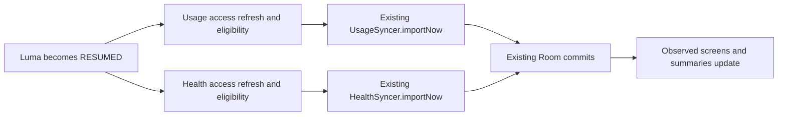

# Automatic App Usage and Steps Updates on Open

**Status:** Proposed specification; implementation has not started.

**Request:** Automatically update app usage and the step counter when Luma opens, and generate a specification and implementation plan.

**Intent:** Show the latest available imported observations without requiring an Import tap on every visit. Keep capture and browsing usable while imports run.

**Assumptions:** “Open” includes both a cold launch and returning to active use. “Step counter” means Luma’s existing Health Connect daily step totals. Existing optional import switches and permissions continue to control access. These assumptions can be revised during review.

## Current behavior and scope

`LifeOsApp` mounts `UsageForegroundRefresh` and `HealthForegroundRefresh` above its navigation graph. Each uses `repeatOnLifecycle(STARTED)` to call `refreshAccess()` once, then waits for lifecycle cancellation. Neither calls `importNow()`, so returning to Luma updates access status without fetching new observations.

`LumaApplication` already shares one `UsageSyncer` and one `HealthSyncer` across the app. Imports validate access and opt-in, serialize reads per integration, commit through Room, and update observed data. Usage also has an existing six-hour WorkManager schedule. Health imports use Health Connect aggregation over the last seven calendar dates in a saved import timezone.

This change adds foreground import triggering to those existing paths. It does not add a device-sensor step source, continuous counting, polling while the app stays open, a background health worker, a new auto-update preference, or changes to import windows and persistence.

## Approach

| Approach | Tradeoff |
| --- | --- |
| Extend the existing foreground hooks — selected | Reuses application-wide wiring, shared syncers, cancellation, and repository observation; requires a small change in each hook. |
| Put imports directly in `MainActivity.onResume()` | Ties integration behavior to the Activity and introduces separate coroutine ownership alongside the existing Compose hooks. |
| Introduce a central import coordinator | Can support future scheduling policies, but adds shared state and interfaces that this requirement does not need. |

Keep two independent hooks. Use `Lifecycle.State.RESUMED` so an attempt starts when Luma becomes active, including returning from native access screens. `repeatOnLifecycle` cancels a block below its chosen state and restarts it when that state is reached again. The selection of RESUMED is a product decision for this feature. [Android lifecycle API](https://developer.android.com/reference/androidx/lifecycle/RepeatOnLifecycleKt).

## Global constraints

- Keep `minSdk = 28`, `compileSdk = 35`, `targetSdk = 35`, JDK 17, AGP 8.7.3, Kotlin 2.2.10 and Compose BOM 2025.08.01.
- Keep AndroidX Lifecycle 2.9.0, coroutines 1.10.2 and Health Connect 1.1.0-beta01; add no dependency or database migration.
- Add no permission, network access, telemetry, AI service, sensor listener or background health read.
- Existing usage and health import switches remain the opt-in; opening Luma must never enable either integration or launch permission UI.
- Keep English, Persian and French available offline; update import explanations in all three resource bundles.
- Preserve existing import identities, history coverage, checkpoints, seven-date health reconciliation and saved health import timezone.
- Missing observations remain unavailable; explicit zero remains zero; failures and cancellation retain the last successfully committed data.

## Required behavior

### F1 — Activation and attempt frequency

Start one access-refresh/import attempt per integration when its root hook becomes RESUMED: after cold launch, background return, screen-unlock return, or return from a native permission/access screen that paused Luma. The integration must be supplied to `LifeOsApp`; null optional integrations perform no work.

Do not trigger imports from ordinary recomposition, tab navigation, opening an in-app dialog, or import-state emissions. Do not add a timer, retry loop, cooldown, or recurring foreground job. A recreated Activity may cause another attempt; stable import identities must make that safe. A failed attempt retries on the next activation or through the existing manual controls.

Changing an import switch while Luma stays RESUMED retains its existing behavior: enabling refreshes access, and data imports on the next activation or an explicit manual import. Returning from a native permission screen causes the automatic attempt; the existing Health Connect result callback may also refresh access, but must not independently launch a second automatic import.

### F2 — Eligibility and access

For each attempt, call `refreshAccess()` first, then take the first current value from `observeState()`. Call `importNow()` only when `enabled == true` and the refreshed status is eligible:

| Integration | Eligible statuses | Skip import for |
| --- | --- | --- |
| Usage | READY, NO_DATA, ERROR, INTERVAL_CHANGED | DISABLED, ACCESS_REQUIRED, LOCKED, UNAVAILABLE; any disabled state |
| Health | READY, NO_DATA, ERROR | DISABLED, ACCESS_REQUIRED, UPDATE_REQUIRED, UNAVAILABLE; any disabled state |

ERROR remains eligible so a previous transient failure can recover without manual intervention. INTERVAL_CHANGED remains eligible so existing usage clock-safety recovery can proceed. Status eligibility is a scheduling hint: `importNow()` remains authoritative and must recheck permission and opt-in before querying and before committing. No permission prompt or provider installation launches automatically.

The existing `refreshAccess()` guards ensure disabled integrations do not query their providers; usage can still cancel obsolete scheduled work. An observation or access-refresh exception stops only that attempt.

### F3 — Independent execution and lifecycle cancellation

Run usage and health in their existing separate `LaunchedEffect` scopes. A slow or failed usage attempt must not prevent a health attempt, and the reverse must also hold. Start asynchronously without delaying initial UI rendering or navigation.

When Luma leaves RESUMED or a hook leaves composition, cancel its pending foreground coroutine. Propagate `CancellationException` through the attempt function and lifecycle wrapper. Do not display cancellation as an integration error or begin further provider reads from the cancelled attempt. A transaction already completed remains a valid saved snapshot; a cancellation must not undo it.

After a returned outcome or caught non-cancellation exception, wait for lifecycle cancellation. This keeps a completed or failed attempt from running again during the same activation. Android native usage queries may finish before cancellation is observed; retain the existing cancellation, opt-out and transaction protections.

Automatic imports, manual imports, access-refresh callbacks and usage background work share the existing syncer instances and mutexes. Same-integration operations serialize; queued requests may run sequentially. Cross-trigger coalescing is not required. Repeated imports must update the same records rather than append duplicates.

### F4 — Data and display

Delegate to existing `importNow()` implementations without calculating totals in the UI:

- Usage retains its checkpoint/overlap logic, bounded seven-day session reread, native aggregate fallback, clock-change quarantine and partial-history labels.
- Health refreshes the existing seven-calendar-date window, including today through query time, in the stored import zone. At exact local midnight, the existing window builder omits today’s zero-length interval.
- Health continues using `StepsRecord.COUNT_TOTAL` aggregation with no origin filter. Health Connect accounts for overlapping activity sources according to app priorities. [Health Connect aggregation](https://developer.android.com/health-and-fitness/health-connect/aggregate-data).
- Successful imports update Room records, invalidate derived summaries, and flow into Today, Timeline, saved usage views and Review through their existing observations.
- Missing health observations, successful source deletions, and known zero retain their existing reconciliation rules. Provider/access failures retain history and successful checkpoints.

Show saved values while new data is being fetched; do not reset them to zero, clear screens, move the selected date, or discard capture drafts. Existing Settings status and last-sync values reflect import outcomes. Automatic work does not introduce a global loading screen, success toast, or a new persisted busy state. An unexpected exception that cannot record status retains the previous status and last-sync value.

The freshness promise is the provider data available when queried. Inferring from the existing snapshot-import architecture, Luma cannot make a source app write newer Health Connect data or guarantee that physical steps already appear in that source.

### F5 — User-facing explanation

Retain the current switches, Import buttons, refresh/retry controls and explicit permission explanations. Replace the existing English resource values with this copy, and provide equivalent Persian and French translations:

`usage_access_explanation`:

> When imports are on and Android Usage access is granted, Luma updates app names and foreground usage each time you open or return to the app. Usage can also refresh in the background. You can import manually from Settings. Imports stay on this device. You can revoke access at any time. Turning imports off keeps previously saved records.

`health_explanation`:

> Optionally allow Luma to read step totals from Health Connect. When imports are on and read-steps access is granted, Luma updates the last seven calendar dates, including today so far, each time you open or return to the app. You can also import manually from Settings. Totals stay on this device and appear in Today, Timeline and saved summaries. Health Connect combines overlapping sources. Luma does not write health data or read sleep or workouts. Step totals reflect data currently available in Health Connect.

Update README and privacy documentation to distinguish automatic foreground imports from access-only refreshes. Preserve the existing explanation of usage background work, health foreground reads, opt-out and retained copies.

## Acceptance criteria

| ID | Observable result |
| --- | --- |
| A1 | With both imports enabled and access granted, cold launch saves provider usage and steps without tapping Import. |
| A2 | After provider values change while Luma is inactive, returning to RESUMED updates usage and steps; Today’s observed summary shows the new values. |
| A3 | Recomposition, in-app dialogs and tab changes during one activation do not repeat the attempt. Activity recreation can import again without duplicate records. |
| A4 | Both disabled, usage-only, health-only, denied/locked usage, and unavailable/update-required health all obey the eligibility table and keep core screens usable. No automatic permission UI opens. |
| A5 | Granting access through a native screen while imports are enabled leads to import on return to RESUMED. Denial/revocation retains saved values and reports the existing access status. |
| A6 | An ERROR status and usage INTERVAL_CHANGED can recover on the next activation; neither causes a retry loop. |
| A7 | A blocked or failed integration does not stop its counterpart or navigation. Leaving RESUMED cancels pending automatic work without an error or an incomplete commit. |
| A8 | Opt-out during an import prevents late writes; overlapping manual/background attempts serialize and do not duplicate saved records. |
| A9 | Zero, unavailable observations, successful source deletion, midnight/DST and a changed device timezone retain current import semantics and the stored health zone. |
| A10 | Existing last-sync displays update after successful imports; manual controls remain available; English, Persian and French explanations describe automatic foreground updates. |

## Verification and delivery

Use focused JVM tests for access-before-import ordering, every status in the eligibility table, disabled guards, post-refresh state selection, recovery and cancellation. Use controlled-lifecycle Compose tests for RESUMED transitions, independent effects, cancellation and unchanged attempt counts during recomposition. Use in-memory Room with fake providers to verify that automatic imports update actual observations and Today without duplicate records.

Reuse existing domain, adapter, Room and Settings tests for import windows, null/zero, history safety, serialization and opt-out races. Compile the app and instrumentation tests, run app lint and the existing translation-catalog check, and record native Usage Access/Health Connect permission round trips separately from fake-provider tests.

This delivery contains only this specification and the linked [implementation plan](../plans/2026-10-14-auto-update-on-open.md). Product behavior has not changed, and no implementation or device validation is claimed.
