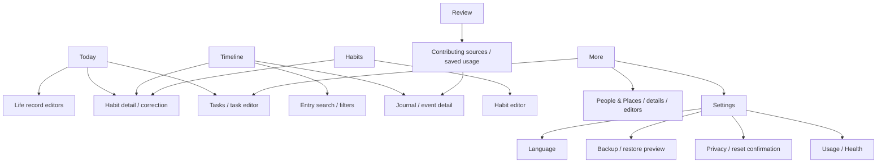

# Luma UI/UX audit

Audit date: 19 October 2026. Source baseline: working tree at `7f9165a`; existing uncommitted documentation and untracked artifacts were present. Companion documents: [Design system](DESIGN_SYSTEM.md), [Implementation tasks](IMPROVEMENT_TASKS.md), [Optional opportunities](UX_OPPORTUNITIES.md).

## Executive assessment

Luma has a credible Android-native foundation: offline capture, a restrained green palette, Material 3 controls, reversible memory promotion, protected drafts, and explicit permission and data-retention boundaries. Its five primary destinations form a reasonable structure for a private life record. A complete redesign would discard useful work without addressing the most consequential problems.

The main weakness is uneven behavior between feature families. Date changes, failed mutations, restoration, detail navigation and accessible feedback do not all follow the same contracts. Some errors retain state internally but lose their visible recovery controls. Dense explanations and inconsistent headers then make the experience feel more complicated than its core actions require.

**Assessment:** usable foundation with significant reliability, accessibility and consistency work before broad release. **Confidence:** high for the cited source structures; medium for inferred runtime consequences; medium for the limited rendered phone review; low for untested large-text, screen-reader, tablet, OEM and destructive/provider flows. No numerical usability score is assigned without representative task testing.

The first release-blocking candidate is **F01**, where a Habits date change can present old actionable rows beneath a new date. This is established as a reachable source path, not a reproduced wrong-date write. Fix and regression-test that path before cosmetic work. The existing full-suite failures also need diagnosis; their presence alone does not prove product defects.

## Scope, evidence and limitations

Evidence labels used throughout:

- **S — Source-confirmed:** directly inspectable structure or reachable state path. A consequence described as a risk has not necessarily been reproduced.
- **O — Observed:** actually viewed in this session on the installed emulator app. Applies only to the stated state, configuration and build.
- **H — Historical:** repository documentation/test evidence; not rerun here.
- **V — Validation required:** plausible risk requiring a device, accessibility service, fixture or measurement. Not a confirmed failure.

Read the README, architecture, original task/status documents, privacy/backup documentation, recent Habits/Tasks specifications and acceptance records, previous UX reviews and their implementation updates. Reviewed the navigation graph, theme/resources, UI families, relevant state holders and repository boundaries. Current source takes precedence over older reviews.

### Actual UI review

ADB was initially blocked by the sandbox socket restriction; the permitted emulator check subsequently succeeded. Used **emulator-5562, API 36**, existing `com.luma.lifeos` installation, **version 0.1.0 / code 1**, last-update metadata `2026-10-19 13:43:42`. Display: **1080 × 2400 px, density 420 (about 411 × 914 dp), font scale 1.0, English, light theme, portrait, gesture navigation**. The installed APK was not rebuilt or cryptographically matched to this working tree; observations corroborate visible patterns, not every source change.

| Observation | Actually inspected | What it supports |
| --- | --- | --- |
| O01 | Empty Today | Direct capture choices; prominent Habits/Tasks setup cards; repeated zero-task wording; compact page title |
| O02 | Empty Timeline | Very large title plus app label/Search/date/usage switch/timezone/count/order stack; empty card and capture FAB |
| O03 | Empty Habits | Fixed app-bar title; tracking-zone explanation precedes setup; duplicate Add habit entry points |
| O04 | Empty current-week Review, initial viewport | Week-in-progress context; large overview with repeated integration actions; later sections require scrolling |
| O05 | More | Three outlined destination cards; large heading; clear Tasks/People & Places/Settings labels |
| O06 | Empty Open Tasks list | Text Back in top bar; two large filter chips; count plus empty card and Add task |
| O07 | Untouched Mood editor | Close icon; timestamp row; five score options; emotion chips; collapsed optional context; disabled sticky Save |

Captured and inspected temporary screenshots during review; no screenshot files are added to the repository because deliverables are restricted to four Markdown documents. An initial capture showed launch splash only and was excluded as usability evidence. One attempted Mood capture still showed Today and was also excluded; O07 uses the later confirmed editor image. Returned from the untouched editor to Today. No record was created, changed, deleted or restored; no integration permission or import preference was changed.

**Not tested live:** populated capture/save/delete/conflict flows, habits logging/correction, search queries/filters, settings subpages, dark theme, French/Persian layouts, TalkBack/Switch Access, hardware keyboard, 200% text, landscape/tablets, process death, native file/photo/permission results, real Health Connect, reset or restore. No build or automated suite was run for this documentation-only task. All such recommendations carry S/H/V evidence rather than invented visual results.

`docs/ux-review-2026-10-18/README.md` lists old screenshots, but that directory currently contains only the README; its linked PNG/XML assets were unavailable. The 19 October Tasks evidence directory contains separate historical artifacts. Neither historical inventory establishes current visual acceptance. `docs/TODO_ACCEPTANCE_2026-10-19.md`, especially its failure register, reports **14 app and 2 data instrumentation failures** that remain undiagnosed. Earlier README pass counts do not override that later record.

## Product understanding and principal journeys

**Purpose:** privately record and revisit personal life on-device. Core records are mood check-ins, journals and memories, with reusable people/places and private photos. Habits record repeated completions; Tasks track one-time work with optional civil due dates. Timeline, saved daily summaries and deterministic Weekly Review support recall and reflection. Usage and steps are optional observations, never prerequisites.

**Users:** inferred from product documentation, people who want a private offline life record and lightweight personal tracking. No user research, age/disability profile or retention analytics was supplied. English, French and Persian/RTL are explicitly supported; Gregorian dates are intentional. Do not introduce an account, social layer, streak pressure or cloud/AI dependency as an audit fix.

| Journey | Current route / effort | Evaluation |
| --- | --- | --- |
| Record a mood/journal/memory | Today → direct action → editor → Save | Good low-tap path; optional context already disclosed progressively |
| Capture while browsing | Timeline/Review → Quick Capture → type → editor → Save | Appropriate global capture; task branch explicitly differs from dated life capture |
| Add a person/place during capture | Expand context → New → create → return → find/select new item | Parent draft preserved, but missing selection result creates avoidable work (F09) |
| Log a habit | Today/Habits → Log; Undo or detail for corrections | Efficient, but date consistency and feedback require F01/F02 |
| Complete a task | Today due-task checkbox or More → Tasks → checkbox | Strong pending/conflict controls; off-preview errors and reload Retry need F03/F04 |
| Find a record | Timeline → Search → query/filter → result → source | Scope narrower than generic Search suggests; no universal body/habit/task search (F10) |
| Inspect weekly evidence | Review → section → sources or saved usage → record | Section chooser already exists; secondary bars and selected-log targeting vary (F07/F11) |
| Connect optional signals | More → Settings → Integrations → explanation → Android/provider UI | Accurate consent boundary; preserve access/import distinction |
| Protect or remove data | More → Settings → Backup/Privacy → native picker or confirmation | Deliberate safeguards; clearer feedback and scanability needed |

Primary tabs are Today, Timeline, Habits, Review and More. Search/Tasks/catalogs/settings are secondary. Back-stack save/restore and `launchSingleTop` are present (`ui/LifeOsApp.kt:160`). Today/Timeline/Habits share selected day; Review selects its own week. Core navigation is not missing. Preserve this architecture and clarify time context rather than adding more primary tabs.

## Strengths to preserve

1. Full semantic light/dark schemes, including container surfaces, in `ui/theme/Theme.kt`; no need for a new brand palette.
2. Material controls provide standard interaction/selection semantics and feedback. Decorative icons often correctly use null descriptions; null is not automatically an accessibility defect.
3. Capture has dirty-close confirmation, busy guards, sticky IME-aware actions and existing retry. Journal pending tags are validated/accepted on Save.
4. Stable capture identities and private draft photo leases protect many interrupted operations. Most editor families reconcile ambiguous deletion; Mood is the exception identified below.
5. Memory promotion retains one underlying entry; unmarking differs from deleting a direct memory.
6. Missing metrics, recorded zero, disabled imports, permission/provider problems and partial history already have distinct models and copy.
7. Quick Capture already fully expands, scrolls and distinguishes now from browsed date. Earlier reports of concealed choices should not be copied forward as current defects.
8. Habits already split scheduled/other rows, adapt row action placement and provide correction safeguards. Review already has a Sections dialog and sticky context.
9. Tasks already preserve protected drafts, use revision checks, handle mutation tokens, and offer Undo/retry/conflict states. Full-list off-page errors are already handled.
10. Explicit permission explanations, backup validation/replacement preview, irreversible reset confirmation and external-copy boundaries fit the privacy promise.

## Consolidated findings

Complexity: **Low** = focused presentation/state change; **Medium** = coordinated route/state/component work; **High** = repository/large-data/lifecycle change. Priority describes user harm, not visual severity. Every finding maps to a task with the same number, e.g. F03 → UX-03.

| ID | Priority / evidence / complexity | Problem, user consequence and prescribed change |
| --- | --- | --- |
| F01 | **P0 Critical**, S, Medium | Habits `selectDate()` changes header date but retains previous `days`; rows remain enabled, and `log()` uses `row.day.date`. A slow/failed date load can let the user write to the prior date under the new date. Clear/disable mismatched rows and reject mismatched date/generation at mutation boundary. `habits/HabitsViewModel.kt:52,61,101,109`; `HabitsScreen.kt:67,110,128`; `TodayHabitsCard.kt:78`. Reproduce with delayed observation before claiming runtime occurrence. |
| F02 | P1 High, S, Medium | Today Habits does not render `actionError`; Undo failure can be invisible. Full Habits places success/Undo/error after all rows, possibly offscreen. Use persistent, adjacent operation feedback and retry, plus a snackbar for successful Undo availability. `TodayHabitsCard.kt:34`; `HabitsScreen.kt:195`; `HabitsViewModel.kt` Undo/action-error paths. |
| F03 | P1 High, S, Medium | Today task failures are only rendered inside the three visible rows. Missing/conflicted/reordered tasks can leave `rowErrors` without any recovery UI. Render retained off-preview failures independently, as full Tasks already does. `todo/TodayTasksCard.kt:90`; `TodayTasksViewModel.kt:174`; `TodoListScreen.kt:168`. |
| F04 | P1 High, S, Low | Conflict → Reload latest → repository failure leaves `conflict=true,error=LOAD`; visible Retry calls a method that returns early on conflict. Route LOAD recovery through the explicit reload path without discarding text again. `TodoEditorViewModel.kt:154,175,195`; `TodoEditorScreen.kt:125`. |
| F05 | P1 High risk, S/V, Medium | Mood note is unbounded and copied into saved-state Bundle on every change. Very large paste can threaten restoration capacity; no crash was reproduced. Add a 5,000 UTF-16-code-unit limit for new edits with retained accepted text/error, preserving pre-existing longer saved values for viewing/copying; do not silently truncate. `mood/MoodEditorViewModel.kt:102,174`; `core/domain/src/main/kotlin/com/luma/lifeos/domain/model/Mood.kt`. |
| F06 | P1 High, S, Medium | Mood deletion has no persisted pending-delete reconciliation; a committed deletion with lost completion can reopen a generic LOAD error. Mood restored draft fields also disappear while `ready=false`. Reconcile durable delete intent and show retained values read-only during failure. `MoodEditorViewModel.kt:81,136`; `MoodEditorScreen.kt:116`. |
| F07 | P1 High, S, Medium | Opening a Timeline habit log passes its ID, but detail loads latest 50 and ID only changes a test tag. An older chosen repetition may be absent and has no visible/semantic highlight. Load a bounded anchor window and focus/highlight that record; show a clear missing-record state. `LifeOsApp.kt:210,425`; `HabitsViewModel.kt:305,313`; `HabitHistory.kt:47`. |
| F08 | P2 Medium, S, Low | Every habit detail action error uses correction-specific retained-draft copy, including delete and load-more failures. Use operation-specific feedback/retry next to its action. `HabitDetailRoute.kt:187`; `HabitsViewModel.kt:193,428`. |
| F09 | P2 Medium, S, Medium | Inline New person/place returns only navigation completion, not selected identity; users must find/select the item they just created. Return a consumed result to the origin editor and auto-attach when allowed. `LifeOsApp.kt:430,474,511`; `people/PersonEditorRoute.kt:35`; `places/PlaceEditorRoute.kt`. |
| F10 | P1 High, S, Low | “Search” can imply all saved content, but only entry titles/linked catalog names are queried; journal body, notes, habit logs and tasks are excluded. Label “Search entries” and offer concise scope help before a result is trusted. Do not change query scope in this fix. `search/SearchRoute.kt:49`; `core/data/src/main/kotlin/com/luma/lifeos/data/search/SearchSql.kt:17`; `res/values/strings.xml:394`. |
| F11 | P2 Medium, S/O, Medium | Secondary Back/title patterns vary: shared pinned detail bar, text Back inside scrolling Privacy/Review usage, separate tall Settings headers, and Task text Back. Use shared pinned M3 top bars. Privacy visible Back disables while busy but system Back lacks the same route guard; preserve the confirmed NonCancellable reset boundary. `common/DetailTopBar.kt`; `settings/SettingsRoute.kt:26,65`; `privacy/PrivacySettingsRoute.kt:64`; `review/ReviewUsageRoute.kt:32`; `ReviewSourcesRoute.kt:31`; `todo/TodoListScreen.kt:78`. |
| F12 | P2 Medium, S/O, Medium | Title hierarchy varies from Today `titleLarge` to Timeline/More `headlineLarge`, Review headline styling and native bars. Gutters vary 16/20/24 dp; card insets 12/14/16/20 dp; Habit timeline uses 5 dp gaps. The rendered empty pages visibly change scale. Adopt role-based typography/spacing, retaining compact daily actions. `TodayScreen.kt:91`; `TimelineRoute.kt:71,76`; `more/MoreRoute.kt:35`; `HabitTimelineCard.kt:33`. |
| F13 | P1 High validation, S/V, Medium | Nested shell/default Scaffold and TopAppBar inset ownership differs from zero-inset `DetailTopBar`. This is a potential duplicated-space/IME issue, not proven overlap. Outer `LifeOsApp.kt:192` pads NavHost; `EditorTopBar.kt:23` and editor/Habits Scaffolds use defaults. Establish one inset owner and test gesture/three-button/IME/cutout configurations. |
| F14 | P1 High validation, S/V, Medium | No width-class navigation/content policy exists; most routes fill width. Date rows, five-option scales and multi-control headers need narrow/font-2.0 checks. Add content-width/stacking rules and rail navigation for wider windows after measured validation. Existing Habit/Review adaptive rows should be retained. `PrimaryNavigationBar.kt`; `DayNavigation.kt:26`; `MoodEditorScreen.kt:124,189`; `MemoryEditorScreen.kt:136`; `LifeOsApp.kt`. |
| F15 | P1 High, S/V, Medium | Async feedback semantics are inconsistent: backup results, language failure, catalog/detail failures, Timeline errors and Today task load error use plain Text while editors/integrations use `AccessibleFeedback`. Important updates may need manual discovery by screen-reader users. Standardize polite announcements/error distinction, page/section headings and focus recovery; verify actual speech. `backup/BackupSettingsCard.kt:62`; `language/LanguageSettingsCard.kt:49`; `people/PeopleRoute.kt:76`; `timeline/TimelineRoute.kt:97`; `TodayTasksCard.kt:71`. |
| F16 | P2 Medium, S/V, Medium | Capture people/place/tag pickers eagerly compose the full catalog as chips, pushing later fields far away. Searchable lazy selectors should retain visible selections, constraints and create actions. Large-data latency is unmeasured. `PersonPicker.kt:58`; `PlacePicker.kt:55`; `JournalEditorScreen.kt:191`. |
| F17 | P2 Medium, S, Medium | Duplicate names are distinguishable by stored IDs but not picker labels; users can attach/filter the wrong Alex/place/tag. Apply meaningful context or stable short identity suffix consistently before and after selection, including screen-reader labels. `search/SearchOptionPicker.kt:44`; `PersonPicker.kt:59`; `PlacePicker.kt:58`; `ActiveSearchFilters.kt:84` partly solves selected duplicates. |
| F18 | P2 Medium, S/H/V, High | Person/place histories load/map/sort complete record graphs and then sort again in UI. Older Search/Review large-fixture performance misses are documented, not remeasured. Bound catalog histories; profile current Search/Review before choosing optimization. `core/data/src/main/kotlin/com/luma/lifeos/data/entity/PersonWithEvents.kt`; `PlaceWithEvents.kt`; `RoomPersonRepository.kt:16`; `RoomPlaceRepository.kt:17`; `PeopleRoute.kt:135`; `PlacesRoute.kt:115`; `docs/VALIDATION.md`. |
| F19 | P2 Medium, S, Low | Memory promotion renders the full original journal body before marker fields; a permitted 50,000-character entry buries the action. Use a six-line excerpt and explicit source expansion while keeping marker note/importance near the top. `memory/MemoryEditorScreen.kt:109`. |
| F20 | P2 Medium, S, Medium | Photo import/removal shares editor busy state, so the Save label becomes “Saving…” during copying/cleanup. Expose Adding photo/Removing photo states and attachment-level progress; only genuine record saves say Saving. `photos/PhotoDraftSession.kt:37,48,60`; `JournalEditorScreen.kt:111`; `MemoryEditorScreen.kt:81`. |
| F21 | P1 High accessibility, S/V, Low | Photo Remove buttons all have the same accessible name. Image numbering elsewhere does not disambiguate the button list. Label Remove photo N and restore logical focus after removal. `photos/PhotoGallery.kt:62,101`. |
| F22 | P2 Medium, S, Low | Habit history formats time independently with Java localized formatters; other call sites use shared helpers whose default hour cycle is fixed rather than always device-aware. Unify display formatting while preserving recorded zone and precision. `habits/HabitHistory.kt:53,56`; `language/LocalizedFormats.kt`. |
| F23 | P2 Medium, S, Low | Successful retry of integration configuration observation can retain stale `actionError`. UI uses `retryConfiguration()` rather than `refresh()`, which existing tests exercise. Separate observation/action failure and clear each when its actual operation recovers. `HealthSettingsViewModel.kt:23`; `UsageSettingsViewModel.kt:24`; `HealthSettingsCard.kt:79`; `UsageSettingsRoute.kt:70`. |
| F24 | P2 Medium, S, Medium | Privacy policy is accurate but long and mixes several decisions in large paragraphs. Add summary + named independent disclosures and direct Integrations navigation; keep external-copy/reset boundaries visible. `privacy/PrivacySettingsRoute.kt:37`; `res/values/strings.xml:510`; standalone `health/HealthRationaleActivity.kt`. |
| F25 | P2 Medium validation, S/V, Medium | Permission explanation/restore preview use unscrollable modal columns. Search picker has a 320 dp list plus fixed header/input/status. At large font/landscape/IME, actions may be crowded. Use bounded scrollable modal bodies; promote selectors to full-screen when available height requires it. `PrivacySettingsRoute.kt:109`; `BackupSettingsCard.kt:78`; `SearchOptionPicker.kt:33`. |
| F26 | P2 Medium, S/O, Low | Today empty Tasks repeats the same state in count and body; large setup cards and permanent Habits timezone prose compete with daily actions. Compress empty previews to one message + action, disclose routine timezone explanation while keeping mismatches visible. Review repeats integration actions for missing metrics; provide one clearly scoped setup action in the overview. `TodayTasksCard.kt:82`; `TodayHabitsCard.kt:67`; `HabitsScreen.kt:99`; `review/ReviewOverview.kt`. |
| F27 | P2 Medium, S, Low | EventCard can advertise “Edit mood” or “Edit memory” in its click label while Timeline actually opens a detail route. Today opens those records directly in editors. Align the semantic action with the destination; standardize browse-to-detail and retain explicit edit shortcuts. `timeline/EventCard.kt:36`; `LifeOsApp.kt:141`; `TodayScreen.kt:139`. |
| F28 | P2 Medium, S, Low | Journal detail uses `requireNotNull(get())`; missing entries look like load failures with endless retry. Distinguish missing from recoverable read error, as generic EventDetail already does. `journal/JournalDetailRoute.kt:41`; `timeline/EventDetailRoute.kt:81`. |
| F29 | P3 Low, S, Medium | Backup has only transient outcome, no installation-local last-successful-export status; Privacy advises exporting without a shortcut. Useful optional reassurance, already proposed in older UX-18. Add qualified local history only after archive stream closes successfully. `BackupViewModel.kt:13,27`; `PrivacySettingsRoute.kt:77`. |
| F30 | P3 Low, S, Low | Expanded integration disclosures become generic “Hide details”; people/place choose toggles lack explicit expansion semantics. Preserve named subject and expanded/collapsed state. `common/DetailsDisclosure.kt:22`; `UsageSettingsRoute.kt:102`; `HealthSettingsCard.kt:105`; `PersonPicker.kt:42`; `PlacePicker.kt:39`. |
| F31 | P3 Low, S/V, Medium | Fixed 240 dp photo preview is not an inspection tool; no full-screen/zoom path and preview decode is bounded to 640 px. A private viewer could improve record recall; a richer viewer is optional rather than a failed core capture task. `photos/PhotoGallery.kt:100`; `core/domain/src/main/kotlin/com/luma/lifeos/domain/model/Photo.kt`; `AndroidPhotoCodec.kt:20`. |
| F32 | P3 Low, S, Medium | Generic photo error cannot distinguish oversized/unsupported/provider/storage failures, despite Retry already existing. Typed causes could provide specific recovery without discarding draft/attachments. `PhotoDraftSession.kt:45`; `PhotoGallery.kt:46`. |
| F33 | P0 release gate, H/V, Medium | Latest acceptance record reports unresolved app/data instrumentation failures. They may involve stale assertions, fixtures or product behavior; do not blindly update expected text/order. Diagnose isolated cases and rerun full suites on disposable data before release acceptance. `docs/TODO_ACCEPTANCE_2026-10-19.md:189`. |
| F34 | P2 Medium, S, Low | Tasks formats the initial empty page total as zero even before the first valid snapshot or after initial failure. Hide unknown counts; retain a qualified prior count only after a successful snapshot. `todo/TodoListScreen.kt:70,118`; `TodoListViewModel.kt:42` (`TodoListUiState`). |
| F35 | P2 Medium, S, Medium | Review source context names only the generic metric kind, not the selected person/place/emotion/activity. Resolve a bounded display label while preserving stable query identity; unavailable or same-name entities need distinct context. `review/ReviewSourcesRoute.kt:33`. |

## Visual system and accessibility assessment

### What is actually inconsistent

- **Hierarchy:** primary screen title has different roles/sizes; Settings headers occupy multiple lines of chrome while detail bars are compact. O01–O07 corroborate the scale changes.
- **Geometry:** arbitrary 5/6/10/12/14/16/20/24 dp choices have no documented role mapping. Not every different value is a defect; task UX-12 replaces inconsistent *roles*, not every numeric literal.
- **Surface hierarchy:** filled setup cards dominate Today while More/Settings use outlined navigation cards. Both are valid M3 patterns, but their responsibilities need explicit rules. Keep outlined navigation and use restrained tonal grouping for content, not a filled box around every empty sentence.
- **Action labels and placement:** close icons, text Back and icon Back vary; repeated “View all,” “Retry,” “Remove” and “Hide details” need context in accessibility navigation.
- **State behavior:** Tasks handles off-page errors, while Today does not; some editors retain visible drafts on failure, Mood hides them; plain errors differ from live semantic feedback.
- **Time presentation:** localized general time helpers coexist with independent HabitHistory formatting; tracking-zone prose is always visible while important timezone differences need prominence.

### Contrast evidence

Calculated WCAG sRGB relative luminance from the opaque colors in `Theme.kt` (host Python calculation in this session). These are **token-pair calculations, not a rendered contrast audit**. Sample pairs:

| Pair | Light ratio | Dark ratio |
| --- | ---: | ---: |
| onSurface / surface | 16.07:1 | 14.23:1 |
| onSurfaceVariant / surface | 8.78:1 | 10.84:1 |
| primary / surface | 7.05:1 | 10.92:1 |
| onPrimary / primary | 7.51:1 | 7.75:1 |
| onPrimaryContainer / primaryContainer | 11.16:1 | 7.20:1 |
| error / surface | 6.06:1 | 10.85:1 |
| outline / surface | 4.19:1 | 5.86:1 |
| onSurfaceVariant / surfaceContainer | 7.94:1 | 9.59:1 |

These samples support retaining the palette. They do not establish every state pair, alpha blend, disabled control, photo overlay or system-bar combination. No contrast violation was established. Verify actual uses rather than recommending brighter colors without evidence. Normal text should meet 4.5:1, large text 3:1; relevant non-text controls need 3:1. See [WCAG contrast guidance](https://www.w3.org/WAI/WCAG22/Understanding/contrast-minimum.html) and [non-text contrast](https://www.w3.org/WAI/WCAG22/Understanding/non-text-contrast.html).

### Accessibility and Android checks

Material components supply many roles/minimum targets automatically; a visually small chip is not proof of a sub-48 dp hit target. The app also explicitly sets 48 dp in many rows. Audit measured hit rectangles and neighboring overlap, particularly five-option scales and custom combined rows, before declaring a violation. [Compose accessibility defaults](https://developer.android.com/develop/ui/compose/accessibility/api-defaults) explain the distinction.

Saved state should remain small; Android explicitly cautions against large Bundle payloads in [Compose state-saving guidance](https://developer.android.com/develop/ui/compose/state-saving). This supports F05 as a structural risk, not proof of a measured crash.

The highest-confidence accessibility gaps are inconsistent async error semantics and indistinguishable photo actions (F15/F21). Missing heading roles on primary/section text and expanded controls need a shared contract. Font scaling, TalkBack traversal, keyboard selection, focus after dialogs/removal, date-picker IME and window responsiveness remain acceptance work, not passed checks. Use [Android layout/navigation guidance](https://developer.android.com/design/ui/mobile/guides/layout-and-content/layout-and-nav-patterns) and [Compose inset guidance](https://developer.android.com/develop/ui/compose/system/insets-ui) for the adaptive/inset changes.

## Complete screen-by-screen review

Each row states purpose, problems/impact, concrete recommendation/benefit and implementation priority. “No distinct defect established” means the inspected implementation has no additional finding; it is not visual acceptance. Shared F references carry the detailed evidence above. Base source path is `app/src/main/java/com/luma/lifeos/` unless a core module is named.

| Screen / purpose and source | Problems and why they matter | Recommendation / expected benefit | Complexity / priority |
| --- | --- | --- | --- |
| Today: daily capture and previews; `ui/today/TodayScreen.kt`, `TodayRoute.kt`, `TodayCaptureActions.kt` | F01–03/F12/F26/F27; failed actions can be invisible, empty previews repeat text, mixed browse/edit behavior | Fix date/action contracts; compact empty previews; standard title; open details predictably. Faster, trustworthy daily use | Medium / Critical for F01; High for recovery |
| Saved daily summary disclosure; `ui/summary/DailySummaryCard.kt` | Good missing/zero/retry/provenance separation; no new calculation defect established. Disclosure/accessibility governed by F15/F30 | Retain derived-data explanations and independent retry; named disclosure, heading and font-scale validation | Low / Medium |
| Timeline: daily browsing; `ui/timeline/TimelineRoute.kt` | F07/F10–15/F27; tall metadata stack pushes feed down, selected habit target can be lost, action hint can misstate destination | Compact header: title + Search, date row, collapsed display options/timezone help; keep counts/order readable; fix target and labels | Medium / High |
| Event detail: read manual/imported source; `EventDetailRoute.kt` | Already distinguishes missing/error/read-only and has pinned bar; F12/F15/F21/F31 apply | Standard spacing/feedback and contextual photo actions; preserve typed imported detail and source/zone | Low / Medium |
| Habits list: scheduled logging/browse; `HabitsScreen.kt`, `HabitsRoute.kt` | F01/F02/F12–14/F26; stale-date actions, distant Undo, always-on zone introduction | Atomically bind header/rows/actions; adjacent recovery; concise zone with expanded explanation, visible mismatch | Medium / Critical |
| Habit editor: name/target/schedule/lifecycle; `HabitEditorRoute.kt` | Dirty guards/schedule validation already exist; F13–15/F25 apply; complex weekday/target controls need large-text validation | Keep one clear save; adaptive groups and shared inset/bar contracts; verify field focus and pending effective-date explanation | Medium / High validation |
| Habit detail/management/history; `HabitDetailRoute.kt`, `HabitManagementSection.kt`, `HabitHistory.kt` | F07/F08/F22; selected repetition not reliably located, inaccurate failures and time inconsistency | Anchored history, selected semantic highlight, typed recovery, common formatting; improves correction confidence | Medium / High |
| Habit correction dialog; `HabitLogCorrectionDialog.kt` | Precision/dirty guards already present; date/time controls need F25 matrix; recorded zone is preserved internally | Retain recorded precision and DST rules; scroll body with reachable Save/Cancel; context-specific error | Medium / Medium validation |
| Tasks list Open/Completed; `todo/TodoListScreen.kt`, `TodoListRoute.kt`, `TodoRow.kt` | Strong bounded paging, off-page errors and Undo; F11/F12/F14/F15/F34 apply; unknown initial counts appear as zero; two large chip filters can overemphasize peer selection | Standard top bar and M3 equal-status filter treatment with accessible selected state; retain error recovery independent of rows | Medium / Medium |
| Task editor/create/status/delete; `TodoEditorScreen.kt`, `TodoEditorViewModel.kt` | F04; conflict/load failure yields ineffective Retry. Other revision/draft guards are strengths | Explicit load recovery path; keep title/note/due date and conflict notice; verify status/delete without accidental draft loss | Low / High |
| Today task preview; `TodayTasksCard.kt` | F03/F26; error disappears with row, repeated empty message | Render errors independently; one empty sentence and Add; count only when nonzero. Reduces confusion | Medium / High |
| Weekly Review: compare saved periods; `review/WeeklyReviewRoute.kt`, `ReviewHeader.kt`, `ReviewOverview.kt`, `ReviewSections.kt`, `ReviewHabits.kt` | Existing Sections chooser resolves prior discovery finding; F12/F14–15/F26 and H performance caveat remain. O04 empty overview repeats setup actions | Compact shared overview setup action; keep partial-week/coverage explanations and section chooser; test late-section access at font 2.0 | Medium / Medium |
| Review sources: inspect contributors; `ReviewSourcesRoute.kt` | F11/F14/F15/F35; fixed verbose context can consume height and omits the selected entity name | Pinned shared bar; move range/metric/zone to scrolling content summary; preserve criteria and page on return | Medium / Medium |
| Review saved usage day; `ReviewUsageRoute.kt` | F11/F15; Back/title scroll away | Pinned shared bar; retain date/coverage and read-only evidence. Makes return predictable | Low / Medium |
| Memory-only Review fallback; `memory/MemoryReviewRoute.kt` | Reachable only when reviews repository absent; source-read, not runtime visited. F12/F15/F27 | Keep fallback functioning and shared card action semantics; no new standalone feature needed | Low / Low |
| More hub; `more/MoreRoute.kt` | O05 labels clear; F12/F14 only; Tasks secondary destination is reachable through Today too | Preserve three destinations, normalize title/gutter, constrain width; avoid adding another primary tab | Low / Medium |
| People & Places catalog tabs; `people/PeopleRoute.kt`, `places/PlacesRoute.kt` | F12/F15/F17; duplicate names/long catalogs harder to scan | Consistent titles and row semantics; meaningful duplicate identity; validate tab restoration | Medium / Medium |
| Standalone Places legacy route; `PlacesRoute.kt` | Same catalog concerns; not a separate required primary destination | Keep compatibility route; apply shared catalog treatment rather than expose redundant navigation | Low / Low |
| Person detail/shared history; `people/PeopleRoute.kt:103` | F15/F18; unbounded full-history work despite lazy rows | Bounded stable history pages, persistent return position and accessible retry; preserve oldest-first label | High / Medium |
| Place detail/shared history; `places/PlacesRoute.kt:82` | F15/F18; same full-history work; coordinates are read-only context | Same history paging contract; preserve place context and non-location-permission design | High / Medium |
| Person editor; `PersonEditorRoute.kt` | Dirty/deletion/bounds safeguards exist; F09/F13/F15 | Return new identity to originating capture and keep normal catalog creation unchanged; shared chrome/errors | Medium / Medium |
| Place editor; `PlaceEditorRoute.kt` | Same as person; no evidence location permission is needed | Same result contract and editor system; preserve optional/manual nature | Medium / Medium |
| Mood capture/edit; `mood/MoodEditorScreen.kt`, `MoodEditorViewModel.kt` | F05/F06/F13–15; potential huge-note restoration, hidden restored data and ambiguous delete recovery | Bounded edit text with visible error; retain read-only draft during failure; persisted delete intent; validate five scores at 320 dp/2.0 | Medium / High |
| Journal capture/edit; `journal/JournalEditorScreen.kt` | Good pending-tag validation and retained draft; F09/F13/F16–17/F20–21 | Searchable tag/context selection and auto-link returns; operation-specific photo progress, shared accessible labels | Medium / Medium |
| Journal detail; `JournalDetailRoute.kt` | F15/F21/F28; deleted record looks retryable forever | Explicit missing state with Back, preserve real errors and pinned edit bar; photo action consistency | Low / Medium |
| Direct Memory capture/edit; `memory/MemoryEditorScreen.kt` | F09/F13–17/F20–21; weighted importance controls need scaling checks | Same editor/picker/photo contracts; optional importance stays optional | Medium / Medium |
| Remember mood/journal/unmark; same memory screen and `MemoryStatus.kt` | F19; full original content buries marker task | Excerpt plus Read original/Expand; marker inputs near top; distinguish Remove memory marker from Delete entry | Low / Medium |
| Search entries/results; `search/SearchRoute.kt` | F10/F15/F18; expectation gap plus historical large-fixture delay | Explain exact scope; retain initial/no-match/empty distinctions and debouncing; profile before optimizing | Low copy / High priority |
| Search filter dialog + dates; `SearchFilters.kt` | Filters apply live; no evidence changes are lost. F25 validation; nested modal/keyboard behavior untested | Keep live-selection semantics clear; bounded body, visible Clear dates/Close, invalid-range feedback; preserve query on Reset filters | Medium / Medium |
| Search option selectors; `SearchOptionPicker.kt`, `ActiveSearchFilters.kt` | Search/lazy list/unknown-removal already exist; F17/F25 | Distinguish same-name options preselection; adaptive modal height; keep unknown selected IDs removable | Medium / Medium |
| Settings hub; `settings/SettingsRoute.kt` | F11/F12; tall separate Back/title structure | Shared pinned bar and outlined destination rows; retain inline theme for quick access | Low / Medium |
| Language settings; `language/LanguageSettingsCard.kt`, `AppLanguages.kt` | Radio group/recreation already implemented; F15 error semantics; locale visual matrix untested | Accessible save failure; preserve drafts/dates on locale switch; test English/French/Persian, initial device-language fallback and OS-managed app-language changes | Low / Medium |
| Theme settings; `theme/ThemeSettingsCard.kt`, `Theme.kt` | Good three-way preference, semantic pairs and system bars; F14/F15 validation | Retain palette and System/Light/Dark; verify dialogs/status bars/selection in both modes | Low / Medium validation |
| Backup/export/restore settings; `backup/BackupSettingsCard.kt`, `BackupViewModel.kt` | Strong validation/confirmation; F15/F25; optional F29 | Announce outcome, bound preview content; preserve explicit replacement and no-task warning; optional qualified local status | Medium / High accessibility |
| Privacy/local data/reset; `privacy/PrivacySettingsRoute.kt`, `PrivacyViewModel.kt` | F11/F24/F25; accurate but hard to scan; Back mismatch during OS request | Summary/disclosures + direct existing destinations, pinned guarded Back, visible reset boundaries; test destructive path only on disposable app ID | Medium / Medium |
| Integrations landing; `settings/IntegrationsSettingsRoute.kt` | F11/F12/F23/F30; retained action errors can misrepresent recovered state | Consistent page chrome, independent accurate status/retry, named disclosures | Medium / Medium |
| Usage integration settings/status; `usage/UsageSettingsRoute.kt` | Accurate access/import separation; F23/F25/F30; real provider validation pending | Clear recovered errors; retain saved history, zone/partial-day coverage and Manage access while off | Medium / Medium |
| Health Connect integration; `health/HealthSettingsCard.kt` | Same recovery/modal issues; provider install/update states exist | Keep access/import/provider distinctions, precise steps-only scope and recorded-zone explanation | Medium / Medium |
| Standalone Health rationale activity; `health/HealthRationaleActivity.kt` | Database-free scrollable policy is appropriate; F24/F14 validation | Reuse accurate structured policy and explicit Close; verify external launch/RTL/insets without opening database | Low / Medium |

### Dialogs, sheets and reusable components inventory

This inventory covers transient surfaces that are not independent navigation destinations.

| Surface / owner | Existing contract | Remaining review / linked work |
| --- | --- | --- |
| Quick Capture modal sheet, `QuickCaptureSheet.kt` | Fully expanded, scrolling, now/browsed date and separate task branch | Keep all choices reachable; named heading, font/landscape and focus-return checks (UX-14/15/25) |
| Today past-date choice, `TodayCaptureActions.kt` | Explicit selected-day vs now; dismiss does not capture | Validate long localized actions; no need to remove safety choice |
| Day picker, `DayNavigation.kt`; Review week picker, `WeeklyReviewRoute.kt:178` (launcher in `ReviewHeader.kt`) | Native M3 date selection and Cancel | Preserve date on cancel; large-text/RTL/keyboard checks |
| Shared capture timestamp dialog, `CaptureTimestampRow.kt` | Scrollable date/time; timezone disclosure; DST feedback; Done/Cancel | UX-13/14/22/25; preserve original seconds if time unchanged |
| Mood/journal/memory/person/place/habit/task dirty-close dialogs | Confirm discard of unsaved work | Retain; Back/close share path; focus returns to trigger on Cancel |
| Mood/journal/direct-memory/catalog delete, memory-unmark dialogs | Explicit destructive confirmation; effects differ | Keep operation-specific copy and missing-record recovery (UX-06/28) |
| Habit management/delete and repetition delete confirmations | Separate habit vs repetition effects; Skip applies directly | Operation-specific failures and adjacent retry (UX-08) |
| Habit date/time correction dialog | Dirty/precision/future checks | UX-25 responsive modal acceptance |
| Task due-date picker, delete confirmation, reload-latest confirmation | Civil date, explicit no date, protected draft/conflict | UX-04; do not conflate task due date with capture occurrence |
| Task completion/reopen feedback and completion Undo | Mutation tokens, duplicate guards, shared SnackbarHost | Preserve; test return focus and stale Undo after restore |
| Review methodology/info dialogs and Sections chooser | Existing disclosures and complete section destinations | Keep full section inventory; font-2.0/keyboard/focus validation |
| Search filters/date/option dialogs | Live criteria updates, retained selections, unknown removal | UX-17/25; nested dismissal pops only the top modal |
| People/place inline pickers; journal tags | Constraints/error/retry/create/selected removal | Replace full option expansion with bounded chooser (UX-09/16/17/30) |
| Photo picker and gallery error/retry/remove | System image-only picker; private copies; unavailable preview | UX-20/21/31/32; native cancellation/provider lifecycle validation |
| Backup native Create/Open document pickers | Cancellation has no successful result; no automatic backup | Test only disposable export/restore; UX-15/25/29 |
| Restore replacement preview | Validated counts/date and explicit replacement warning | Scrollable body and semantic outcome; keep no-task loss warning |
| Reset confirmation | Irreversible local scope, app closure, external-copy caveats | Preserve; never infer erasure from accepted request |
| Usage/Health explanation dialogs + Android/provider UI | Continue launches external request; Cancel does not grant | UX-23/25/30; avoid treating granted access as enabled imports |
| PrimaryNavigationBar, DetailTopBar, EditorTopBar | Native selection; shared detail/edit chrome | UX-11–15/27; one inset contract and correct action semantics |
| EmptyStateCard, AccessibleFeedback, DetailsDisclosure | Reusable empty/feedback/disclosure patterns exist | Extend existing components; avoid another competing component system |
| EventCard, HabitRow/TimelineCard, TodoRow, ReviewValue | Shared content presentation per feature | Role typography, compact metadata, contextual action labels; preserve separate record semantics |

## Implementation direction

Implement UX-01 first; run UX-33 diagnosis in parallel with planning subsequent work, not as a reason to guess fixes. Then resolve invisible/dead recovery, Mood draft/delete risks, selected-log routing and semantic action/feedback defects. Apply the shared design contracts to one representative flow, validate it across sizes/locales, then migrate the remaining screens in small tasks. Keep optional backup history/photo viewer/search expansion outside the correctness work.

Detailed dependencies, copy decisions, test fixtures and acceptance criteria are in [IMPROVEMENT_TASKS.md](IMPROVEMENT_TASKS.md). Device-only checks remain explicitly open until executed against an identified build.
